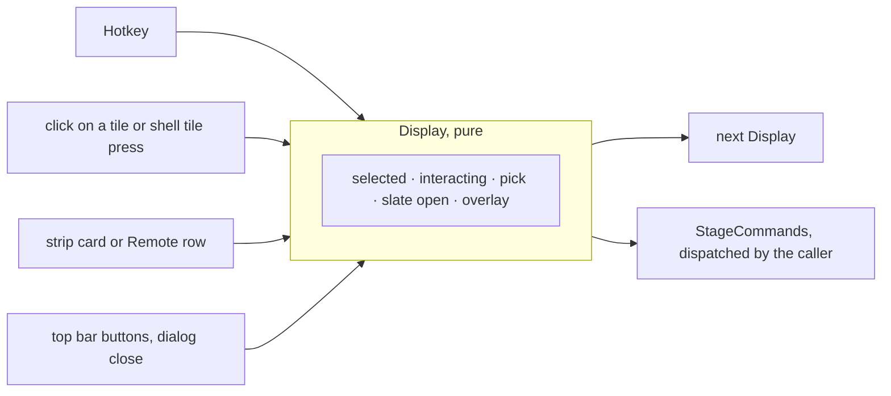

# The Display Module: Design

Date: 2026-10-04
Status: Approved 2026-10-04

A Display's local state moves out of `App`'s body into one pure module, `Display`. That state is the selected tile,
the interacting tile, the pick, the slate drawer, and which overlay is open. Today these are seven `useState` calls,
and the rules that tie them together are written inline in `App`, again in `TopBar` (solo or unsolo), and again in
`RemoteView` (drop, then select the next empty tile). Commit `bbcf06d` fixed "interacting follows the selected
tile" in `App.tsx` alone, and no test could have caught that bug.

After this change, `Display` holds that state and answers every input with the next state and the stage commands
to send. App, TopBar, and the Remote use it, and none of them keeps a copy of its rules. Every rule is tested
without React.

Little a person sees changes. The changes are listed under [What a person sees change](#what-a-person-sees-change).

Source: architecture review of 2026-10-04, candidate 3, which takes in how hotkeys are handled. The decisions were settled with the user in two
grilling rounds. ADR 0003 is unchanged: the Stage stays the Hub's, and Display holds only what CONTEXT.md already
calls local to the Display.

## Goal

- One module owns the Display's local state and its rules. It is a pure, immutable value with methods, and it has
  no React in it.
- Each input answers with `{ display, commands }`, and the caller dispatches the commands.
- At most one overlay is open: the key help, the command palette, or the join-Remote dialog.
- A selected slot that no longer exists after a layout change reads as the last slot, without anything reacting to
  the Stage changing.
- The Remote selects and drops through the same module.

## Today

| Rule | Where |
| --- | --- |
| Selecting another tile ends interacting | `App.tsx:26-29` (`select`) |
| Interacting counts only while the selected slot still holds that game | `App.tsx:31-33` |
| Drop a card, set the pick, select the next empty tile | `App.tsx:43-49`, again in `RemoteView.tsx:108-111` (without the pick) |
| Solo the selected tile or unsolo | `App.tsx:59`, again in `TopBar.tsx:78-80` |
| Esc closes the key help first, then unsolos | `App.tsx:60-63` |
| `SelectTile` is ignored past the last slot | `App.tsx:73` |
| Key help, palette, and join dialog are three independent booleans | `App.tsx:34-36` |

## Shape



## Decisions

### `apps/web/src/Display.ts`

An immutable class (`Data.Class`). It sits at the web app's top level, beside `App.tsx`, because both the Display
and the Remote use it. It imports only `@sportal/domain`, `@sportal/api` (`Hotkey`), Effect, and `slate/StripCards.ts`.
There is no React in it.

```ts
/** A Display's local state: what is selected, interacting, picked, and open. Never sent to the Hub. */
class Display extends Data.Class<{
  readonly selected: number                  // a slot, as last chosen; read through selectedOn
  readonly interacting: GameId | undefined   // read through interactingOn
  readonly pick: GameId | undefined
  readonly slateOpen: boolean
  readonly overlay: Overlay                  // None | Keys | Palette | JoinRemote, not exported
}> {
  static readonly initial: Display           // slot 0, nothing interacting or picked, slate open, no overlay

  /** The selected slot on this Stage: the last slot when the layout now has fewer. */
  selectedOn(stage: Stage): number
  /** The interacting game, while the selected slot still holds its stream; otherwise none. */
  interactingOn(stage: Stage): GameId | undefined

  press(hotkey: Hotkey, stage: Stage, cards: ReturnType<typeof stripCards>):
    { display: Display; commands: ReadonlyArray<StageCommand> }
  select(slot: number, stage: Stage): { display: Display; commands: ReadonlyArray<StageCommand> }
  drop(card: ReturnType<typeof stripCards>[number], stage: Stage):
    { display: Display; commands: ReadonlyArray<StageCommand> }
  toggleSlate(): Display
  open(overlay: "Keys" | "Palette" | "JoinRemote"): Display
  close(): Display
}
```

- The `{ display, commands }` shape is written inline in each signature, as AGENTS.md asks of a return shape. It is
  not a named type.
- `Overlay` is a `Data.taggedEnum` private to the file. Nothing outside the file names it. App reads
  `display.overlay._tag`.
- `select` and `drop` take the Stage, so they can clamp the slot and pick the next empty one. Nothing else in
  Display reads the Stage except through `selectedOn` and `interactingOn`.

### The rules, as transitions

| Input | Next Display | Commands |
| --- | --- | --- |
| `select(slot)`, slot on stage | selected = slot; interacting ends if the slot changed | none |
| `select(slot)`, slot past the last | unchanged | none |
| `drop(card)`, card free or benched | pick = card; selected = the next empty slot after the selected one, or the same slot; interacting ends if that changed | `Assign` or `Swap` into `selectedOn(stage)`, as `StripCards.drop` decides today |
| `drop(card)`, card on stage | unchanged | none |
| `press(SelectTile n)` | as `select(n)` | none |
| `press(ToggleSolo)` | unchanged | `Solo selectedOn(stage)`, or `Unsolo` while soloed |
| `press(Unsolo)` (Esc) | an open overlay closes, and nothing else happens | none |
| `press(Unsolo)` (Esc), no overlay | unchanged | `Unsolo` while soloed, otherwise none |
| `press(Interact)` | interacting = the selected slot's stream game, or ends if it was on; nothing happens on a non-stream tile | none |
| `press(StepPick ±1)` | pick = `nextPick(cards, pick, step)` | none |
| `press(DropPick)` | as `drop(the picked card)`; nothing happens with no pick | as `drop` |
| `press(ToggleSlate)` | as `toggleSlate()` | none |
| `press(ShowKeys)` | Keys opens, or closes if it was open | none |
| `press(CommandPalette)` | Palette opens, or closes if it was open | none |
| `press(FocusAudio n)`, `press(Promote n)`, `press(NextLayout)` | unchanged | `FocusAudio`, `Promote`, `SetLayout(Layout.next)` |
| `press(FullScreen)` | unchanged | none. App handles it before Display, because it is a shell or browser effect. |
| `open(o)` | overlay = o, replacing any other | none |
| `close()` | overlay = None | none |

`StripCards.drop` folds into `Display.drop`, and `nextPick` stays in `StripCards.ts` as an operation on the strip.
`StripCards.drop` and its tests move into `Display`. Nothing else uses it, and a second copy would be duplication.

### Callers

- **App** keeps one `useState(Display.initial)` and a local `apply({ display, commands })` that sets the display and
  dispatches each command. That is about five lines, with no hook file. Every `useState` the table above lists is
  gone. `useHotkeys` handles `FullScreen` itself, and passes every other hotkey to `display.press`.
  `StageView.onSelect`, including the shell's tile press, calls `display.select`. Dialog `onOpenChange(false)`
  calls `display.close()`, and the top bar's buttons call `open` or `toggleSlate`.
- **TopBar** no longer decides solo or unsolo. Its button calls the `ToggleSolo` path through a callback from App,
  and it receives `selectedOn(stage)` for its `disabled` check.
- **Remote** keeps a `useState(Display.initial)`. Its rows call `display.drop`, and its stage map calls
  `display.select`. It never opens an overlay or interacts.
- **CommandPalette** is unchanged in this piece. Its "Watch in tile n" still assigns to the selected slot it is given,
  and App now passes it `selectedOn(stage)`.

## What a person sees change

- With the key help open, `?` closes it as before, and `Ctrl+K` now replaces it with the palette instead of opening
  both.
- After a Remote shrinks the layout, the selected tile is the last tile, instead of a slot that no longer exists.
  Drops and solo go there.
- On the Remote, a drop now also sets the pick, which the Remote does not show.

## Testing

`apps/web/src/Display.test.ts` covers every row of the transition table, with the stages built from `Stage.initial`
plus commands and test games, as `StripCards.test.ts` builds them. These cases are named outright because each one
was a bug or is easy to break:

- Selecting another slot ends interacting. Selecting the same slot keeps it.
- Interacting reads as none once a Remote's swap moves another game into the selected slot.
- `selectedOn` after the layout shrinks from Quad to Single is 0, and a drop then assigns into slot 0.
- Esc with the key help open closes it and sends no `Unsolo`, even while soloed.
- Opening the palette while the key help is open leaves only the palette open.
- A drop of a benched card swaps it in and selects the next empty slot.
- A drop of a card already on stage does nothing.
- `DropPick` with no pick does nothing.

`StripCards.test.ts` loses its `drop` cases, which move here. No React component tests are added.

## Documents that change

- `CONTEXT.md`, the **Display** row: add "Its local state (selected tile, interacting tile, pick, slate drawer, and
  the one open overlay) is the web UI's `Display`."
- `docs/technical-spec.md`, the web tree: `Display.ts` at the top level, described as "A Display's local state and its
  rules".

## Not in this piece

- The shell sync behind StageView (review candidate 4).
- The command palette going through `drop`, so that it also selects the next empty tile.
- Showing the pick on the Remote.
