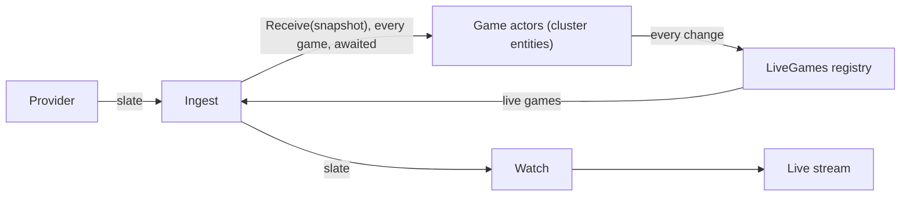

# Game Actors — Design

Date: 2026-10-04
Status: Approved 2026-10-04; refined while planning

Each game the Hub follows gets an actor: an `effect/cluster` entity holding the game's live state in memory, its
staleness timer, and its lifecycle. Ingest's polled snapshots go through the actors, and the slate is published from
what they hold. Little a person sees changes: a game delayed mid-game now shows in the strip's live section, counts in
the top bar's live games, keeps its score on the Remote's stage map, and keeps its channel while its airing is on. What changes is that each game's state, freshness, and failures are its own.

The first of three pieces, in order:

1. **Game actors** (this design), fed by today's scoreboard poll.
2. ESPN FastCast as a live feed: a second source of snapshots into the same actors, and a poll that backs off while
   the push covers the slate. Designed later from `live-feed-design`'s research and fixtures.
3. The Director's watchability and lull work, which can move per-game detection into the actors (see
   [How later pieces fit](#how-later-pieces-fit)).

Depends on [Hub telemetry](./2026-10-04-telemetry-design.md), built first: the actors persist no game state, so their logs,
spans, and metrics are the record of a game day. Decision: [ADR 0006](../adr/0006-live-games-are-actors.md).

## Goal

- Every game on the slate has one actor that alone decides that game's live state. A malformed or unexpected
  snapshot for one game cannot affect another, or the sender.
- A live game nobody has updated for 90 seconds is **stale**, and recovers on its next snapshot.
- A snapshot that is behind the game the actor already has is ignored, whichever feed sent it, so a second feed can
  be added in piece 2 without the actors knowing feeds exist.
- An actor runs while its game is polled often or is current (live, stale for less than 30 minutes since its last
  update, or kicking off within 30 minutes). Once neither holds, it stops 5 to 5½ minutes after its last snapshot,
  or after the game stops being current if that is later. See [Lifecycle](#lifecycle).
- After a Hub restart, a game is current again on its next snapshot. Nothing is stored.
- One game's life can be read back from Grafana: every transition, every ignored snapshot, every defect.

## Today

| What | Where |
| --- | --- |
| Ingest polls every league, keeps the last good slate per league, and publishes the slate as a `SubscriptionRef` | `ingest/Ingest.ts` |
| Nothing per game but the snapshot; no notion of freshness | — |
| `GameSnapshot#progress()` counts a `delayed` game as upcoming, even one delayed mid-game, so the strip shows it among upcoming games and the Remote's stage map hides its score. This piece changes both | `packages/domain/src/Game.ts` |

## Glossary

New rows in `CONTEXT.md`, each in the commit that introduces its type. `LiveGameState` is exported too; the **Live
game** row names it, so it needs no row of its own.

| Term | Meaning | Not |
| --- | --- | --- |
| **Game time** | How far a game has got: before kickoff, in play, or over; then the period; then the clock running down. Orders two snapshots of one game. | timestamp, version |
| **Live game** | One game as the Hub follows it: its latest snapshot and its state (`LiveGameState`): upcoming, live, stale, or over. | game state, entity |
| **Stale** | A live game no snapshot has reached for 90 seconds. It stays current for 30 minutes after its last update, then its actor may stop. | |
| **Game actor** | The cluster entity that follows one game: its live game in memory, its staleness timer, its lifecycle. | durable object, worker |

## Shape

- **Actors see only `GameSnapshot`s.** They do not know which provider or feed sent one. Which snapshot is newer is
  answered by the game itself (game time), not by where it came from.
- **Ingest keeps owning the slate**: which games are on it, in what order, and the last good poll per league. It sends
  every polled snapshot to its game's actor, waits for them all, and publishes the slate with each game as its actor
  has it.
- **Data flows one way.** Actors never call Ingest, Watch, or the Director; they publish to the registry.

## Decisions

### Domain: game time, `packages/domain/src/Game.ts`

| Question | Decision |
| --- | --- |
| The order | `GameSnapshot.gameTime: Order.Order<GameSnapshot>`, a static beside `watchOrder`: by `progress()` (upcoming, live, over), then period, then seconds left descending (the existing `secondsLeft()`). Two snapshots of one game compare by how far the game has got. ESPN gives no version to order by, and none is invented |
| Delayed mid-game | `progress()` counts a `delayed` game that has started (period 1 or later) as live, not upcoming. Otherwise a weather delay would rank behind the snapshots before it and every snapshot during it would be ignored. This also fixes the stage map hiding a delayed game's score. Fixed in `progress()` itself, for every caller, so "has the game started" has one meaning. Polling uses the same meaning: `Cadence` polls every 10 seconds while any game's `progress()` is live, so a weather delay does not slow the poll and flap its actor between Live and Stale |
| Equal game time | Not behind, so taken. The clock stops between plays while the situation and last play move on, and an identical snapshot still says a feed is delivering |

### Domain: `LiveGame`, `packages/domain/src/LiveGame.ts`

| Question | Decision |
| --- | --- |
| The type | `LiveGame`, a `Data.Class` with `snapshot: GameSnapshot` and `state: LiveGameState`. It lives only in an actor's memory and in the registry, never on the wire |
| Its states | `LiveGameState`, a `Data.taggedEnum`: `Upcoming`, `Live { updatedAt }`, `Stale { lastUpdatedAt }`, `Over`. Every operation is a `$match` on the state, so a state added later (piece 2 or the Director's lull) is a compile error at every place that must decide what it means. No boolean flags |
| Which state | Set from the snapshot's `progress()` whenever a snapshot is taken: upcoming is `Upcoming`, live is `Live` at `now`, over is `Over`. `Stale` is reached only by the timer |
| Start | `LiveGame.start(snapshot, now)`: a game's first snapshot, always taken |
| Receive | `liveGame.receive(snapshot, now): Option<LiveGame>`. None when the snapshot is behind in game time: ignored, and it does not refresh `updatedAt`. Otherwise the new live game. Pure, and it assumes the snapshot is of its game: the actor guarantees that |
| Tick | `liveGame.tick(now): Option<LiveGame>`. Some `Stale` when `Live` and `now` is at or past `updatedAt + 90 s`; none in every other case |
| Queries | `liveGame.staleAt(): Option<DateTime.Utc>` (only `Live` has one); `liveGame.isCurrent(now)` (`Live`, `Stale` until 30 minutes after `lastUpdatedAt`, or `Upcoming` kicking off within 30 minutes); `liveGame.currencyChangesAt(now): Option<DateTime.Utc>`, when `isCurrent` next changes with no snapshot: `kickoff - 30 min` for an `Upcoming` game not yet current, `lastUpdatedAt + 30 min` for a `Stale` game still current, none otherwise |
| Stale and current | Decided by the user, 2026-10-04: a stale game is current only for 30 minutes after its last update. Current forever, keep-alive would hold a stale game's actor until the Hub restarts |
| Constants | 90 s, and the two 30 minutes (`currentBefore`, `staleCurrentFor`), are named constants on `LiveGame` |

Transitions (rows: current state; columns: what arrives):

| | Snapshot behind | Snapshot, upcoming | Snapshot, live | Snapshot, over | Tick past `staleAt` |
| --- | --- | --- | --- | --- | --- |
| `Upcoming` | ignored | `Upcoming` | `Live` | `Over` | — |
| `Live` | ignored | (behind) | `Live`, refreshed | `Over` | `Stale` |
| `Stale` | ignored | (behind) | `Live` (recovered) | `Over` | — |
| `Over` | ignored | (behind) | (behind) | `Over`, refreshed | — |

### Game actors: `apps/hub/src/GameActors.ts`

| Question | Decision |
| --- | --- |
| The entity | `Game`, from `Entity.make`, keyed by game id, with one RPC, `Receive { snapshot: GameSnapshot }`, replying with nothing. Pattern: `node_modules/effect/ai-docs/src/80_cluster/10_entities.ts` |
| Messages | Volatile: not annotated `ClusterSchema.Persisted`. Nothing about a game is stored and every snapshot is whole, so a message lost to a restart is replaced by the next poll. This removes what the spike found costly in persisted delivery: three SQL writes per message, tables that grow without bound, and a poisoned message replayed on every start |
| Entity state | A `SubscriptionRef<Option<LiveGame>>`, none until the first snapshot. Every change goes through one private step, `change`: given the live game it has, the step returns the new one, or none when nothing changes (a behind snapshot, a tick before the stale time). A change writes the registry and logs its transition under the state's lock; when nothing changes, nothing is written, logged, or published. Handlers for one entity run one at a time. A snapshot whose id is not the entity's is a defect (`Effect.die`): `GameActors.receive` routes by the snapshot's id, so it can only be a bug |
| Reactions to a change | Two streams over the state's `changes`, forked in the entity's scope. The timer: each live game through `Stream.switchMap`, so every change cancels the old sleep; a live game with a stale time (only `Live` has one) starts a new sleep until `staleAt` and ticks through `change`, so a refreshed game's timer moves with it and a game that goes over or stale leaves no sleep behind. If the sleep ends a moment early, the tick changes nothing and it sleeps the rest of the way. Keep-alive: each live game through `Stream.switchMap` to its `isCurrent` now and again at each `currencyChangesAt`, deduplicated, each value sent to `Entity.keepAlive`; only the latest value matters, so one replaced at once by the next change may never be sent. Each stream runs all its work on a live game (`staleAt`, the clock, `isCurrent`, `currencyChangesAt`, the sleeps, the tick, the keep-alive send) under the defect guard below. The registry is not a stream: it is written in the same step as the change, so `liveGames` has a snapshot's live game as soon as `receive` returns |
| Lifecycle | `maxIdleTime` 5 minutes, counted from the entity's last message. The entity holds `Entity.keepAlive` while its live game `isCurrent` and releases it when it is not. See [Lifecycle](#lifecycle) |
| Defects | `disableFatalDefects: true`, and the handler and all of each stream's work on a live game run under `Effect.catchDefect`: the defect is logged with the game's annotations and the snapshot at hand, counted, and the entity keeps its last good live game. The reply succeeds. A stream carries on to its next change rather than restarting, so a defect that recurs on the same live game is logged once, not in a loop; a live game's timer is set again by its next snapshot. A defect never reaches the sender or another game |
| Registry | `LiveGames`, a `SubscriptionRef` of live games by game id, inside `GameActors`. An entity writes its live game on every change, timer included, and removes it in its finalizer. A reply cannot carry a timer's change, so the registry is how state leaves an actor |
| The service | `GameActors`, a `Context.Service`: `receive(snapshot): Effect<void>` (sends to the snapshot's game and awaits the reply), `liveGames: Effect<ReadonlyMap<GameId, LiveGame>>`, `changes: Stream<ReadonlyMap<GameId, LiveGame>>`. A send can fail with a cluster error (`MailboxFull`, `EntityNotAssignedToRunner`, and others): `receive` logs it at Error with the game's annotations, counts it in `sportal_game_defects`, and succeeds. The game keeps its last good live game and the next poll sends again, so one game never fails Ingest's poll |
| Order | Ingest sends a poll's games concurrently and awaits every reply before the next poll, so a game never has two of one feed's snapshots in flight. Cluster serves an entity's requests one at a time but does not order requests in flight together (found in the spike); game time makes that harmless anyway |

### Lifecycle

`maxIdleTime` counts from an entity's last message, and Ingest sends every game on the slate on every poll. Cluster's
reaper checks every 30 seconds, so an idle actor stops between 5:00 and 5:30 after its last message. On a live slate
(10-second polls) no actor idles out, final games included. On a quiet slate (15-minute polls) every actor idles out
between polls and starts again on the next one. With the user's approval, that is the lifecycle: an actor lives while
its game is polled often or is current. Start and stop log at Debug for a game that is not current and at Info for one
that is, so a quiet slate does not fill the logs.

`isCurrent` depends on the time, so keep-alive is re-evaluated on every change, which includes every snapshot taken,
and again when `currencyChangesAt` says it changes with no snapshot: an upcoming game's window opening, and a stale
game's closing 30 minutes after its last update. A stale game gets no snapshot, so without that it would be current
until the Hub restarts.

### The cluster, single-process

| Question | Decision |
| --- | --- |
| Composition | In `Cluster.ts`, from cluster's public layers: `Sharding.layer` with `Runners.layerNoop`, `RunnerStorage.layerMemory`, `RunnerHealth.layerNoop`, and `ShardingConfig.layer({ entityTerminationTimeout: "1 second", simulateRemoteSerialization: false })`, leaving message storage to its caller. `HubMode.ts` chooses the storage, `MessageStorage.layerMemory`, which also requires the cluster's settings (`Cluster.config`). This is `TestRunner.layer`'s recipe with those two settings. No SQL, nothing written to disk, and cluster reads no environment variables (`SingleRunner.layer` would read `HOST` and `PORT`) |
| In-memory message storage | Decided by the user, 2026-10-04, in place of no-op storage: `Entity.keepAlive(true)` sends a persisted RPC, and with no-op storage that send dies ("Persisted messages require MessageStorage"). Volatile `Receive` never touches the storage. Each `keepAlive(true)` adds one stored entry that is never removed, one each time a game becomes current, and it is gone on restart |
| The two settings | `entityTerminationTimeout` defaults to 15 seconds, which alone would break the Hub's 3-second shutdown bound; at 1 second, closing the cluster with a handler that never finishes takes exactly 1 second. `simulateRemoteSerialization: false`: one process, so snapshots pass as they are |
| The layers | `GameActors.layer` is the service, its entity, and its registry, and requires `Sharding`. `Cluster.layer` provides `Sharding` and requires `MessageStorage`; `HubMode.ts` provides both to the actors, inside the scenario clock in a scenario. `Cluster.layer` waits, using no clock time, until Sharding has acquired its shards, so `Sharding` is not provided before then, because a send before then pays cluster's 100 ms retry. It assumes a single runner that owns every shard |
| Tests | Use the same composition, from `TestCluster.ts`, so tests run the cluster the Hub runs. The keep-alive defect test provides `MessageStorage.layerNoop` instead |
| First task of the plan | Proved the composition. A volatile request replies with no test-clock time passing, the first one that starts the entity included (the spike's 100 ms per request came from persisted messages, which wait on storage polling). Idling works on the clock the cluster is built with, so with the scenario clock an actor idles out in scenario time. Keep-alive does not work with no-op storage, which led to in-memory storage |
| Unstable API | `effect/cluster` is marked unstable. The settings the Hub relies on (volatile delivery, defects not fatal, idle time, keep-alive) are each pinned by a test, so an upgrade that changes one fails a test, not a game day |

### Ingest

| Question | Decision |
| --- | --- |
| What stays | The poll loop, `Cadence`, and the last good slate per league, which says which games are on the slate and in what order |
| What changes | After a poll, every snapshot it returned goes to `GameActors.receive`, concurrently, all awaited. Then Ingest publishes the slate: the poll's games in the poll's order, each replaced by its live game's snapshot (the poll's own snapshot if the actor has none, which happens after a step that was a defect, or when a failed league's kept game's actor has idled out) |
| Between polls | A timer moving a game to `Stale` does not republish the slate in this piece: the slate carries snapshots, and a stale game's snapshot has not changed. Showing staleness to people is a follow-up |

### Telemetry

Every entity log carries `game`, `league`, and `matchup` (`"UGA at BAMA"`) as annotations, so one game's life is one
query in Loki.

| Signal | What |
| --- | --- |
| Log, Info | Each transition: `Upcoming → Live`, `Live → Stale`, `Stale → Live`, `→ Over`, with game time and seconds since the last update |
| Log, Info or Debug | Actor started (on its first snapshot); actor stopped (idle, or the Hub stopping). Info for a game that is current, Debug otherwise (see [Lifecycle](#lifecycle)) |
| Log, Debug | Each snapshot: taken, or ignored as behind, with both game times |
| Log, Error | A defect in the handler, the timer, or keep-alive, with its cause and the encoded snapshot at hand, so it can be reproduced from the log alone; a cluster error from `receive` |
| Span | `GameActors.receive` (sender side), with `sportal.game`, nested under `Ingest.poll`. Cluster already makes a span per request, `Game(<id>).Receive` under its client's `Game.client.Receive`; the handler annotates that one with `sportal.game` and `sportal.league` instead of adding a second |
| Metric | `sportal_game_actors` gauge (running entities); `sportal_live_games` gauge by state; `sportal_snapshots` counter by outcome (taken, behind); `sportal_transitions` counter by from and to; `sportal_game_defects` counter; `sportal_receive_duration` histogram. Cluster's own `ClusterMetrics` come along |
| Dashboard | A "Game actors" row on the Hub dashboard: live games by state over time, snapshots taken and behind, defects, receive latency, and the transition log for a chosen game. Loki keeps `game` as structured metadata, not a stream label, so it has no list of values: the `game` variable is a text box, a game id or a pattern (`.+`, every game, by default) |

### Hub mode

| Question | Decision |
| --- | --- |
| Wiring | `HubMode.ts` provides `GameActors` to `Ingest` in both the live day and a scenario. In a scenario, the actors run on the scenario clock with Ingest, so staleness and idling happen in scenario time |

## Restarts and failures

| What happens | Behaviour |
| --- | --- |
| Hub stops cleanly | Entities stop; each logs its stop. Nothing to save |
| Hub is killed | Nothing is lost that matters: the first poll after start gives every game its snapshot, and its actor is current |
| A snapshot raises a defect | Logged with the snapshot; that game keeps its last good live game; every other game and the poll carry on |
| The timer or keep-alive raises a defect | Logged with the live game's snapshot and counted; the stream carries on to the next change. A live game whose timer failed goes stale 90 seconds after its next snapshot |
| A postponed game is rescheduled | A postponed game is over. If ESPN later lists it as scheduled, that snapshot is behind and ignored; the game comes back as upcoming once its actor has idled out |
| A poll fails for a league | As today: the last good slate is kept. Its live games go stale 90 s later, which is now visible in logs and Grafana |
| ESPN is out for more than 30 minutes | A stale game stops being current 30 minutes after its last update, and its actor idles out. Until the next good poll its game has no live game, so the stale marker is lost; the slate still shows the kept snapshot |
| Events across a restart | An actor starts empty, so it has no "before" to compare with. Nothing consumes events yet; the Director must not assume it sees every one |

## Testing

| What | How |
| --- | --- |
| Game time, test-first | Upcoming before live before over; later period ahead; less time left ahead within a period; equal is equal; a delayed game in the second quarter is live and ahead of the first quarter |
| `LiveGame`, test-first | Every cell of the transition table; stale exactly at 90 s and not before; a behind snapshot does not refresh `updatedAt`; an identical snapshot does; `isCurrent` at the 30-minute edge |
| `GameActors`, on the test clock and the Hub's own cluster composition | A game's snapshots reach its live game; behind snapshots are ignored; stale at 90 s and live on the next snapshot; a defect in one game (a snapshot of another game sent straight to its entity) leaves the others, the sender, and that game's last good state alone; a live game outlasts 5 idle minutes and a final one does not, leaving the registry; after the layer is rebuilt a game is current on its next snapshot; a transition is logged with the game's annotations (a test logger); each metric and the `GameActors.receive` span; a defect in the timer or keep-alive is logged and counted and the stream carries on; a timer that wakes early publishes no change until the stale time |
| Ingest | The existing tests pass unchanged: the slate is what it was. New: the slate keeps the poll's order and takes each game's snapshot from its live game |
| By hand | A scenario at 10× with telemetry on: transitions appear in the Game actors row. A scenario cannot show staleness: after its timeline ends it keeps returning its last frame, so every game is refreshed on every poll. Staleness is checked on a live day instead, by cutting the network for two minutes. A row in `docs/game-day-checklist.md`. `sportal_receive_duration` is measured on the scenario clock, so in a scenario at 10× it reads ten times too long |

## How later pieces fit

- **FastCast (piece 2)** calls `GameActors.receive` with its snapshots, as Ingest does. The actors need no change:
  game time decides between a push and a lagging poll. Naming teams the way the scoreboard does is the FastCast
  adapter's job. Whether the push covers the slate (and the poll can slow down) is a question for Ingest and
  `Cadence`, not for any one game.
- **The Director** compares games and keeps per-Display state (pins, cooldowns, solo), so it is not a game actor and
  actors never call it. It reads `GameActors.changes`, so it can skip a stale game instead of holding everything
  while any data is old. Lull detection needs time passing within one game, which is what an actor's timer is for: a
  lull can become a `LiveGameState`, decided in the Director's watchability piece.
- **Events** for the Director come from the actor's transitions (`snapshot.eventsSince(previous)` where a snapshot is
  taken) once something consumes them.

## Not in this piece

- FastCast and any second feed.
- Showing staleness to people (tiles, the Remote).
- Moving watchability or lulls into the actors.
- Game events from actors.
- Persisted snapshots or stored game state. (Keep-alive's own entries sit in memory storage; see the cluster table.)
- More than one Hub process.

## Documents that change

- `CONTEXT.md`: the four rows above.
- `docs/technical-spec.md`: §3 and §5.1 gain `GameActors` between Ingest and the slate; §4.2's tree gains
  `GameActors.ts` and `LiveGame.ts`.
- `docs/adr/0006-live-games-are-actors.md`: new.
- `docs/game-day-checklist.md`: the row above.
