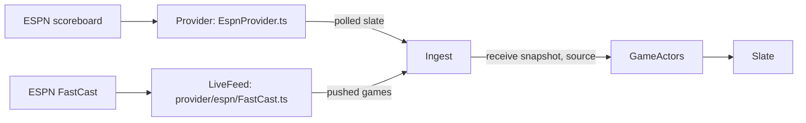

# FastCast — Design

Date: 2026-10-05
Status: Approved 2026-10-05

Piece 2 of the live-feed work. The game actors (piece 1, on `main`) gain ESPN FastCast as a second source of
snapshots beside the scoreboard poll, and the Hub reports what the push delivers as well as it reports the poll.
The aim is to have it running for tonight's Monday Night Football, so this piece is the smallest that does that.

Replaces the approved live-feed design (`docs/specs/2026-10-04-live-feed-design.md` on the `live-feed-design`
branch), which was written before the actors existed. Its research holds and is reused: the
FastCast protocol, the `ws` client, the patch format, and the 2026-10-04 fixtures. Its actor, `LiveGameInput`, and
cluster-storage decisions are superseded by what piece 1 built.

## Goal

- During a live game, a play reaches the Hub when FastCast publishes it: median 28 s from the snap against the
  poll's 40 s, and FastCast delivers 98 of 100 scoring plays together with their score (recorded-days spec).
- Everything the push does can be seen in Grafana: whether it is connected, what it delivers per league and op, why
  it failed, and whether its snapshots or the poll's are the ones the actors take.
- When FastCast fails or ESPN changes it, the Hub keeps working exactly as it does today, on the poll alone.

## Today

| What | Where |
| --- | --- |
| One source: ESPN's site scoreboard, polled per league | `provider/espn/EspnProvider.ts` |
| Every polled snapshot goes to its game's actor; the actor takes it unless it is behind in game time | `ingest/Ingest.ts`, `GameActors.ts`, `LiveGame.receive` |
| Telemetry: the `Ingest.poll` span, `sportal_poll_duration`, `sportal_provider_errors`, the actors' metrics | `telemetry/dashboards/hub.json` |
| No push, so nothing about one in Grafana | — |

## Glossary

New rows in `CONTEXT.md`, each added in the commit that introduces the type.

| Term | Meaning | Not |
| --- | --- | --- |
| **Live feed** | A provider's push connection carrying updates for live games (ESPN FastCast). | socket, stream, webhook |
| **Live feed error** | The live feed could not continue: refused, closed, silent, or an update it could not apply. | |
| **Delivery source** | Which feed a snapshot came from: `push` or `poll`. | origin, feed type |

## Shape

- **Actors still see only `GameSnapshot`s.** FastCast's checkpoint, patches, and `s:20~l:28~e:…` keys stay inside
  `provider/espn/`.
- **Game time decides between the feeds**, as piece 1 designed: a lagging poll is behind in game time and is
  ignored; a poll that has caught up is equal and is taken. `LiveGame` does not change.
- **Ingest owns both feeds.** It already knows each league's listed games, which the push needs (below).

## Decisions

### The port: `provider/LiveFeed.ts`

| Question | Decision |
| --- | --- |
| The port | `LiveFeed`, a `Context.Service`: `games(leagues): Stream<ReadonlyArray<GameSnapshot>, LiveFeedError>`. One element per FastCast message: the games it touched, or every game on a checkpoint. One stream for every league, so the adapter shares one connection |
| No feed | `LiveFeed.none`, a stream that never emits, for tests and scenarios |
| Error | `LiveFeedError`, a `Schema.TaggedError` with `reason`: `Refused` (no host or token), `Closed`, `Silent` (nothing for 45 s), `Gap` (a missed `mid`), `Unapplicable` (a patch that does not apply). The reason is a literal so it can be a metric attribute |

### The adapter: `provider/espn/FastCast.ts`, `FastCastDocument.ts`, `FastCastPayload.ts`

Unchanged from the live-feed design, which was checked against the 2026-10-04 recording:

| Question | Decision |
| --- | --- |
| Connecting | Ask `https://fastcast.semfs.engsvc.go.com/public/websockethost` for a host and token; open `wss://<host>:<securePort>/FastcastService/pubsub/profiles/12000?TrafficManager-Token=<token>`; send `{op:"C"}`, then `{op:"S", sid, tc}` per topic |
| WebSocket client | The `ws` package: Node's built-in `WebSocket` fails ESPN's handshake. Wrapped once, as an Effect `Stream` whose scope closes the socket |
| Topics | `event-football-nfl` (every NFL game), `event-football-college-football` (the ~16 FBS games ESPN features). FBS games it does not carry stay on the poll |
| The document | Per topic, `mid` increases by exactly one across `H`, `R`, `P`, `I`. `H` names a checkpoint to fetch; `R` and `P` are JSON Patch operations keyed by event uid, applied with `JsonPatch.apply` (`copy` becomes an `add`); `B` is a heartbeat. A gap or a patch that does not apply fails the stream, which reconnects from a fresh checkpoint |
| To snapshots | Each touched event is decoded with `FastCastPayload.ts` and mapped to a `GameSnapshot`. Mapping shared with the scoreboard (status, situation) moves to `EspnSnapshot.ts`, not copied. An event that does not decode is logged and skipped |
| Heartbeats | Nothing for 45 s fails the stream with `Silent`, so a half-open socket cannot look healthy |

### Ingest: `ingest/Ingest.ts`

| Question | Decision |
| --- | --- |
| Running the feed | Ingest forks `LiveFeed.games(leagues)` in its scope, retried with exponential backoff and jitter, 1 s to 1 min. Every reconnect starts from a checkpoint, so it is also a full re-sync |
| Team names | FastCast names teams and broadcasts differently from the scoreboard (no `shortDisplayName`). A pushed game is sent as **its listed game advanced to the push**: the listed snapshot's teams, rankings, kickoff, and broadcasts, with the push's status, period, clock, scores, and situation. That is a new `GameSnapshot#advancedTo(later)` in the domain |
| A pushed game nobody listed | Dropped and counted. The next poll lists it within 10 s |
| Sending | `GameActors.receive(snapshot, "push")` for each game of a delivery, concurrently, each awaited, as a poll is. Ingest's `listed` stream is unchanged: the Slate already reads the actors' live games |
| Cadence | **Unchanged in this piece**: a live slate is still polled every 10 s. Slowing the poll while the push covers the slate is the next piece, which must also settle finding C2 of the recorded-days spec (a game's push is silent at every TV break) |

### Game actors

| Question | Decision |
| --- | --- |
| The one change | `receive(snapshot, source: DeliverySource)`. The actor adds `source` to the `sportal.source` span attribute, the `sportal_snapshots` counter, and its Debug log, and passes it to `LiveGame` (see ties, below) |

### Ties between the feeds (added 2026-10-05, from the branch review)

Many changes do not move the clock: a try after a touchdown, a timeout, a touchback, a pre-snap penalty. The push
brings them first; the poll arrives 10–30 s later at the same game time with the old score or down. Taking every
snapshot that is not behind made a game flicker back for up to one poll (13 → 14 → 13 → 14 after each try), and
Watchability saw the score change twice.

| Question | Decision |
| --- | --- |
| Who wins a tie | The push. `LiveGame` records which feed gave its snapshot (`from: DeliverySource`, which moves to the domain). A **polled** snapshot at the **same game time** as a **live** game whose snapshot was **pushed** is not taken: the live game keeps the pushed snapshot |
| Staleness on a tie | The tied poll still refreshes `updatedAt`: it shows the game is being reported, and a game's push is silent for 150–240 s at every TV break, so without this every break would turn the game stale |
| Everything else | Unchanged. A snapshot ahead in game time is taken from either feed; a pushed snapshot at the same game time is taken (an overturned score comes this way); a stale game takes the poll; a game only ever polled behaves exactly as today |
| Known limit | If the push dies just after a change that does not move the clock, the poll's version of a *later* such change waits until the clock moves or the game goes stale. Accepted |
| Telemetry | `sportal_snapshots` gains the outcome `kept` (a tied poll that refreshed a pushed snapshot), beside `taken` and `behind` |

### Scenarios and Hub mode

| Question | Decision |
| --- | --- |
| Live day | `HubMode.live` provides `FastCast.layer` |
| Scenarios | `LiveFeed.none`. Replaying Sunday's recorded push with its delivery times (D5 of the recorded-days spec) is a later piece |

## Telemetry

What you asked for, and the part that is checked on a live day. Names follow `sportal_*` as today.

| Signal | Name | Attributes | Answers |
| --- | --- | --- | --- |
| Gauge | `sportal_live_feed_connected` | — | Is the push up right now (1 or 0)? |
| Counter | `sportal_live_feed_connects` | — | How often it reconnects |
| Counter | `sportal_live_feed_errors` | `reason` | Why it dropped: refused, closed, silent, gap, unapplicable |
| Counter | `sportal_live_feed_messages` | `league`, `op` (`H` `R` `P` `I` `B`) | What it delivers, per league; heartbeats prove a quiet connection is alive |
| Counter | `sportal_live_feed_games` | `league` | Game snapshots it delivered |
| Counter | `sportal_live_feed_undecoded` | `league` | Events ESPN changed so we cannot read them |
| Counter | `sportal_live_feed_unlisted` | `league` | Pushed games no poll has listed yet |
| Counter (changed) | `sportal_snapshots` | `outcome`, **`source`** | Push taken vs poll behind: the poll lagging the push shows as poll `behind` |
| Span | `LiveFeed.delivery` | `sportal.league`, `sportal.op`, `sportal.mid`, `sportal.games` | One per message, parent of its `GameActors.receive` spans, so one push is one trace in Tempo |
| Span | `FastCast.connect` | `sportal.topics` | The handshake and checkpoint fetch, with its failure |
| Logs | Info on connect and on each reconnect with the error's reason; Warning on an undecodable event; Debug per delivery | `league` | |

A **Live feed** row in `telemetry/dashboards/hub.json`: connected, deliveries by league and op, errors by reason,
and "Snapshots taken and behind" split by source. A logs panel for `LiveFeed`.

Measuring how far the push leads the poll per play is left out: it needs the actor to remember when each game time
was first taken, which is a `LiveGame` change. The source split on `sportal_snapshots` answers "is the push ahead"
without it.

## Testing

| What | How |
| --- | --- |
| The document, from the live-feed branch | Its fixtures (the 17:52Z NFL checkpoint, the 101 messages after it, the scoreboard polled at the end) move to `provider/espn/fixtures/`. The checkpoint plus every message gives each live game's score, clock, period, down, distance, and red zone as the scoreboard had them; a lost `mid` fails with `Gap`; an unapplicable patch with `Unapplicable`; another league's topic is ignored |
| `GameSnapshot#advancedTo`, test-first | Takes the later game's in-game fields and keeps the earlier one's teams, rankings, kickoff, and broadcasts |
| Ingest, on the test clock with a test `LiveFeed` | A pushed game reaches the actors and the slate between polls, named as the poll names it; an unlisted pushed game is dropped and counted; a failing feed is retried with backoff and the poll carries on; the poll's existing tests pass unchanged |
| Telemetry, with the test telemetry layer | Each metric above moves with its attribute; `LiveFeed.delivery` is the parent of `GameActors.receive`; `sportal_snapshots` carries `source` |
| Tonight, by hand | `pnpm dev` with telemetry during MNF: the Live feed row shows connected, `P` messages for `nfl`, push `taken` snapshots, and no errors. A row in `docs/game-day-checklist.md` |

## Not in this piece

- Slowing the poll while the push covers the slate, and finding C2.
- Replaying recorded pushes in scenarios (D5) and synthetic faults (D6).
- The push's lead over the poll, per play.
- Plays, drives, and win probability from the per-game gamecast topics.

## Documents that change

- `CONTEXT.md`: the three rows above.
- `docs/technical-spec.md`: the `LiveFeed` port beside `Provider`; §4.2's tree gains `provider/LiveFeed.ts` and
  `provider/espn/FastCast*.ts`, `EspnSnapshot.ts`.
- `docs/adr/`: the live-feed branch's FastCast ADR, renumbered as `0007-fastcast-live-feed.md`.
- `docs/game-day-checklist.md`: the row above.
