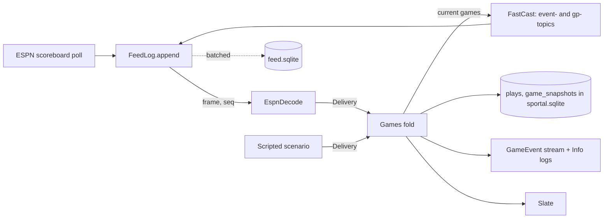

# Feed log — Design

Date: 2026-10-05
Status: Approved 2026-10-05

The Hub keeps everything its feeds deliver in an append-only log, and follows every game with one fold over that
log instead of `effect/cluster` actors. The fold gains each game's plays, from FastCast's per-game topics, and each
game's watchability. Restarts, game-day recordings, and history all become the same mechanism: replay the log.

Supersedes ADR 0004 (snapshots are the truth) with ADR 0008, and ADR 0006 (live games are cluster entities) with
ADR 0009.

## Goal

- Every play of every current game reaches the Hub as a typed `Play`, and every new play is a `GameEvent`.
- A Hub restart mid-game comes back with each game's plays, state, and watchability as they were.
- Every live day is recorded without anyone running `record.sh`, and any logged stretch replays through the same
  code that ran it live, to the same result.
- Past games and plays can be queried for later features.
- The game actors' cluster plumbing is gone.

## Today

| What | Where |
| --- | --- |
| One `effect/cluster` entity per game, single-process, in-memory message storage, keep-alive and shard workarounds | `GameActors.ts`, `Cluster.ts`, `TestCluster.ts` |
| Poll and FastCast (`event-football-<league>` topics only) send `GameSnapshot`s to the actors | `ingest/Ingest.ts`, `provider/espn/FastCast.ts` |
| Watchability folded over whole slates, debounced, recomputed only when a listing or an actor changes | `Slate.ts`, `Watchability.fold` |
| Events derived by comparing two snapshots, never stored | `GameSnapshot#eventsSince` |
| Persisted: only YouTube TV's channel carriage | `source/SqlChannelStore.ts` |
| Game-day recordings: run by hand | `fixtures/espn-recordings/record.sh` |

What the 2026-10-04 NFL recording shows FastCast offers and the Hub ignores: one `gp-football-nfl-<id>` topic per
game, ~1,550–1,970 patches each, ESPN's whole game package. NE at BUF (401872971) touches 182 plays under
`/entities/plays/<id>`, each with a type, period, clock, text, start and end down and distance, yardage, scoring,
score after, and win probability. The rest is box score, odds, leaders, and athlete statistics.

## Glossary

Rows for `CONTEXT.md`, each added or changed in the commit that introduces the type.

| Term | Meaning | Not |
| --- | --- | --- |
| **Feed log** | Every frame the feeds delivered, raw, in the order the Hub received it. The truth the Hub's game state is folded from. | event store, journal, recording |
| **Frame** | One thing a feed delivered: a poll response, a FastCast checkpoint, or a FastCast patch batch. | message, payload |
| **Delivery** | What a frame said about one game: a snapshot of it, from a delivery source, or its whole current list of plays. | input, update |
| **Live game** (changed) | One game as the Hub follows it: its latest snapshot, the delivery source that gave it, its state (upcoming, live, stale, or over), its plays, and its watchability. Folded from deliveries. | game state, entity |
| **Play** (changed) | A single snap, or a timeout, a penalty, or the end of a period, as the game's play-by-play lists it: its kind, clock, text, yardage, start and end, score after, and win probability. | |
| **GameEvent** (changed) | Something that happened in a game: from its plays when it has them, from comparing two snapshots otherwise. Derived, never stored. | alert, update |

Removed: **Game actor**. **Stale** loses "then its actor may stop": a game stops being current, and its FastCast
topic is dropped, 30 minutes after its last update.

## Shape

- **Raw first.** A frame gets its `seq` before anything decodes it.
- **ESPN stays in `provider/espn/`.** `EspnDecode` turns frames into `Delivery`s. The fold never sees an ESPN shape.
- **One fold, one fiber.** Deliveries are applied in `seq` order, so a replay of the same log gives the same games,
  events, and watchability as live did. Applying a delivery is pure and takes microseconds; all I/O is outside the
  fold.
- **Time comes from the log.** The fold's `now` is the frame's `received_at`. Live, that is the clock; in replay, it
  is what makes staleness and lulls come out the same.

## Decisions

### The feed log

Its own database file, `feed.sqlite` in the data directory, beside `sportal.sqlite`, so backups of the small state
database stay cheap. Kept forever.

| Column | Holds |
| --- | --- |
| `seq` | `INTEGER PRIMARY KEY`: the order everything is read in |
| `received_at` | The Hub's wall clock when the frame arrived, epoch ms |
| `sent_at` | ESPN's time: FastCast `ts` or the poll response's `Date` header; nullable |
| `source_id` | FastCast `mid`; nullable. Shows gaps and duplicates in replay |
| `feed` | `poll` or `fastcast` |
| `channel` | The poll's league, or the FastCast topic |
| `kind` | `response`, `checkpoint`, `patches`, `unchanged` (below), or `gap` (below) |
| `body` | The raw bytes, gzip'd; null for `unchanged` and `gap` |
| `body_hash` | Hash of the raw bytes, for `unchanged` |

Index `(channel, seq)`.

- **Polls and pushes share the log.** How they interleave decides the outcome (the push wins a tie), so they need one
  order. Two logs would have to be merged by time, and same-millisecond ties would be arbitrary.
- **No UUIDs.** `seq` already orders strictly and costs nothing; a v7 would repeat `received_at` and still need `seq`
  to break same-millisecond ties. Revisit only if logs from several Hubs must merge.
- **An unchanged poll** (same `body_hash` as the channel's last response) is logged as `kind = unchanged` with no
  body. Decoding reuses the channel's last body.
- **Appends never wait on disk.** One writer assigns `seq` in memory, hands the frame to decoding at once, and writes
  batches every ~100 ms in one transaction. A crash loses at most the unflushed batch.
- **Size.** Poll responses dominate: ~270 KB per NFL scoreboard every 10 s is ~1.2 GB raw a day per league, about
  100–150 MB gzip'd. Expect 5–10 GB a season with FBS. Fine on the planned home box. Compressing across frames (zstd
  with a dictionary, recorded in `kind`) and slowing the poll are later work.
- **FastCast checkpoints are logged** like any frame, since patches only apply to the document before them. Replay
  starts each topic from its latest checkpoint at or before the replay's start.

### Per-game topics

- FastCast subscribes to `gp-football-<league>-<id>` while the fold says that game is current (`LiveGame#isCurrent`:
  live, upcoming within 30 minutes of kickoff, or stale for under 30 minutes) and unsubscribes when it stops being
  current. The fold publishes the current game set as a stream; FastCast follows it.
- `EspnDecode` keeps a `FastCastDocument` per `gp-` topic. A patch batch that touches `/entities/plays` or `/drives`
  becomes `Delivery.Plays` with the game's **whole current play list**, read from the document. Everything else in
  the package is ignored by decoding and kept in the log.
- The `event-football-<league>` topics and the poll decode to `Delivery.Snapshot`, as `Ingest` does today, including
  advancing a pushed game to its listed one.

### `Delivery`

A `Data.taggedEnum` in `packages/domain`, never on the wire.

| Case | Carries |
| --- | --- |
| `Snapshot` | `snapshot: GameSnapshot`, `from: DeliverySource` |
| `Plays` | `game: GameId`, `plays: ReadonlyArray<Play>` (the whole list) |

The whole list, not the new plays, so a corrected play text replaces its earlier version, a play ESPN removes
(nullified, overturned) disappears, and a repeated delivery changes nothing.

### `Play`

A `Schema.Class` in `packages/domain/src/Play.ts`.

| Field | |
| --- | --- |
| `id` | `PlayId`, ESPN's play id |
| `sequence` | ESPN's `sequenceNumber`; orders plays |
| `period`, `clock` | When in the game |
| `team` | Optional `TeamId`: the team with the ball, or that called the timeout |
| `kind` | `rush`, `pass`, `incompletion`, `sack`, `interception`, `fumble`, `punt`, `kickoff`, `fieldGoal`, `extraPoint`, `twoPoint`, `penalty`, `timeout`, `endPeriod`, `other`; mapped from ESPN's type ids in `provider/espn/` |
| `text` | The play-by-play line |
| `yards` | `statYardage` |
| `scoring` | Whether it scored |
| `homeScore`, `awayScore` | The score after it |
| `start`, `end` | `{ down?, distance?, yardsToEndzone? }` |
| `homeWinProbability` | Optional, 0–1. Unused until the Watchability redesign |

### `LiveGame`, folded

`LiveGame` gains `plays` and `watchability`. Its operations:

| Operation | Does |
| --- | --- |
| `LiveGame.start(delivery, now)` | A game's first delivery. A `Plays` delivery before any snapshot is held as plays with no snapshot until one arrives; the plan decides whether that is an `Option` field or a fourth state |
| `take(delivery, now)` | `{ liveGame: Option<LiveGame>, events: ReadonlyArray<GameEvent> }`. `Snapshot` follows today's `receive` rules (game-time order, the push wins a tie). `Plays` replaces the list. Watchability moves on by `Watchability#next` with these events |
| `tick(now)` | Same shape: staleness, and watchability's time-driven changes |
| `wakeAt(now)` | The earliest of `staleAt`, `breakUntil`, `boostUntil`, and `activeAt + 60 s`; none if nothing changes with time |

The fold holds `Map<GameId, LiveGame>`, applies each delivery to its game, and sleeps until the earliest `wakeAt`
across games or the next delivery. In replay it ticks each game at its `wakeAt` instants between frames. A game
leaves the map when it stops being current.

### Events

- Every play new to a game's list is **`Played { play }`**.
- From plays, when the game has any: `ScoreChanged`, `Turnover`, `PossessionChanged`, `TimeoutTaken`,
  `PeriodEnded`, `FourthDown`, and two new tags, **`BigPlay`** (20 or more yards) and **`Sack`**.
- From comparing snapshots, always: `WentToHalftime`, `WentFinal`, `Overtime`, `TwoMinuteDrill`,
  `ReachedScoringRange`, `EnteredRedZone`, `GoalToGo`. And every tag in the list above, for a game with no plays.
- One table in `GameEvent.ts` says which source owns each tag, so nothing fires twice. `Watchability#next` takes the
  events instead of calling `eventsSince` itself.
- Events stay derived: published as a stream from the fold and logged at Info with the game's annotations, never
  stored.

### Watchability

Moves into `LiveGame` with its rules unchanged. `Slate` reads each live game's snapshot and watchability;
`Watchability.fold` over slates goes, and the lull log lines and watchability gauges move to the fold's reporting.
A lull that comes from time passing starts on time instead of at the next listing.

### Derived tables

In `sportal.sqlite`, each migrated by its own store (`Database.migrate`):

- `plays`: one row per play by game, updated in place, deleted when the play is removed.
- `game_snapshots`: each game's latest snapshot only. Per-status history was dropped because the fold's changes are sampled; derive it from an unsampled source when a consumer needs it.

Each records the `seq` it is current to. Both can be dropped and rebuilt from the log.

### What goes

`Cluster.ts`, `TestCluster.ts`, `GameActors.ts` and its tests, the `effect/cluster` dependency, and the keep-alive,
shard, and termination-timeout settings. `Ingest` shrinks to the two feeds appending frames. The `asGame` defect
guard survives as the fold's per-delivery guard.

## Failure handling

| Failure | Behaviour |
| --- | --- |
| A league's poll fails | As today: the league's last good slate is kept |
| FastCast fails | As today: reconnect with backoff |
| A `gp-` topic reports a gap, or a patch will not apply | Fetch that topic's checkpoint again; it is logged as a frame |
| A batch write fails | The Hub keeps following games. Error log, a counter, and a `gap` row with the lost `seq` range and count once writes recover |
| A frame will not decode | Error log with its `seq`, a counter, the frame skipped. The body is in the log, so the bug reproduces exactly |
| Applying a delivery dies | Error log with `seq` and game, a counter; the game keeps its previous state; the fold carries on |
| Startup | Replay the current game day (from 04:00 local) before serving. The plan measures it; if it is slow, saving fold state is follow-up work |
| Shutdown | Flush the pending batch within the existing 3 s bound |

## Testing

- **Domain:** `LiveGame#take` for both deliveries; play revision and removal; the event-source table (each tag from
  one source); `Played`, `BigPlay`, `Sack`; watchability in the fold, including a lull that begins with no delivery.
- **Golden replay:** a dev tool imports the 2026-10-04 NFL recording (`fastcast.jsonl` with its `gp-` topics, and the
  scoreboard responses) into a `feed.sqlite` fixture. Replaying it gives 182 plays for 401872971, every finished game
  final, no decode or fold defects. Two replays give equal results.
- **Restart:** replay half the day, restart, replay the rest; the end state equals one uninterrupted replay.
- **`FeedLog`** on in-memory SQLite: append order, batched flush, unchanged polls, gap rows.
- **Scenarios:** all 19 still pass, as scripted deliveries.
- **Telemetry:** the new counters and the event log lines appear on the Game actors dashboard, renamed for the fold.

## Out of scope

- New watchability or lull rules.
- Showing plays in the web app.
- Recorded scenarios as log slices (the importer above is the start of it).
- Slowing the poll while the push covers the slate.
- Compressing across frames.
- Saving fold state for faster startup.

## Next

**The Watchability rules redesign** is the next spec. After this one it changes one pure function,
`Watchability#next` inside `LiveGame`, and is tuned by replaying logged days. Its inputs:

- each play's `kind`, so breaks (timeouts, the end of a period, a score, a kickoff) are explicit instead of read
  from `lastPlay` text by regex;
- the change in `homeWinProbability` across a play, a measure of how much it mattered;
- real time between snaps: `received_at` of successive plays, and FastCast's `meta/lastPlayWallClock`;
- the snapshot's situation, as today.

Its open questions: what a lull is once timeouts, reviews, and injuries are explicit; whether the score becomes
leverage (win-probability swing weighted by time left) rather than hand-set points; how the Director weighs one big
play against a close game; and which logged days make its test set.

Also queued, from earlier pieces:

- Slow the poll while the push covers the slate (FastCast's open item; also most of the log's size).
- Recorded scenarios as log slices, replacing the scenario push-replay item.
- The live-day staleness check (game-day checklist row 42).
- Hosting piece 2: the home box, which will hold `feed.sqlite`; its backups should treat the log as the large,
  append-only file it is.
