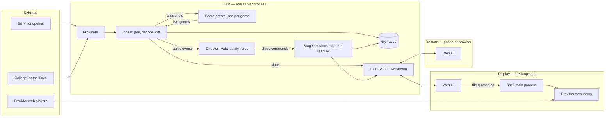

# Sportal — Technical Spec (draft 2)

> Architecture, physical layout, toolchain, coding practices, and domain language.
> Companion to [product-plan.md](./product-plan.md). Draft 2 is rewritten around the plan review: Effect TypeScript, NFL + FBS from the start, several devices on one network, a Hub that can move to a cloud host, and an explicit standard for how files and modules are organized.

## 1. Architectural drivers

1. **Video is not ours.** Provider players are opaque, DRM-protected web pages. Sportal positions, tunes, and mutes them; it never touches the media. Everything about video goes through a narrow **Source** boundary.
2. **Data is unofficial.** Feeds can change shape without notice. Everything about game data goes through a narrow **Provider** boundary and is decoded on the way in.
3. **One Hub, many devices.** A desk display, a TV display, and a phone remote must agree on what is on screen. Therefore all shared state — games, follows, and the state of every Stage — lives in the Hub. Clients render and send commands.
4. **The Hub is portable.** It is a plain server process configured entirely by environment, with storage behind a port. Local today, cloud later, same code.
5. **The tracker stands alone.** Every feature except video playback works in any browser on any device.
6. **One definition per concept.** A domain concept is declared once, as an Effect Schema, and that one declaration serves as the type, the decoder, the wire format, and the storage codec.

## 2. Stack

### 2.1 The Rust and gpui question

You like Effect, Rust, and gpui. Only one of them fits this product cleanly, and it is worth saying why rather than quietly picking.

- **The shell must be Chromium.** Provider players need Widevine. On Linux, the system web view that Rust shells (Tauri, wry, and gpui's web-view component) use is WebKitGTK, which does not play Widevine content in practice. Chromium embedding from Rust exists but is immature. Electron with the castlabs Widevine build is the dependable path.
- **The UI must run on a phone and in a TV browser.** gpui renders natively on desktop only. A gpui UI would mean building the interface twice.
- **A Rust Hub is viable but splits the model.** The Hub could be Rust (axum, tokio, sqlx). It would be fast and pleasant, but every domain concept would then exist in two languages, kept in sync by code generation. That is exactly the type proliferation you want to avoid, bought for performance this workload (polling a few endpoints, pushing to a handful of clients) does not need.

**Decided: Effect TypeScript end to end** — one language, one schema per concept, shared verbatim by Hub, web UI, and shell.

### 2.2 Choices

Versions were checked against the registry on 2026-10-03. Effect is at 4.0, which folded the former platform packages into `effect` itself (`effect/http`, `effect/http-api`, `effect/sql`).

| Concern | Choice | Why |
| --- | --- | --- |
| Language | TypeScript 6, `strict`, `noUncheckedIndexedAccess`, `exactOptionalPropertyTypes`, `erasableSyntaxOnly` | Shared model across every process. Not TypeScript 7 yet: dependency-cruiser does not support it. Erasable-only syntax lets Node run the Hub's source directly, with no build step |
| Core library | Effect 4 | Typed errors, dependency injection by Layer, schedules for polling, streams for live data, a test clock for replaying games |
| Schemas | Effect Schema | The single definition of each domain concept: type, decoder, encoder |
| HTTP API | Effect `HttpApi` (`effect/http-api`) | The API is declared once from domain schemas; the Hub implements it and clients derive a fully typed client from the same declaration — no hand-written request or response types anywhere |
| Live transport | Server-Sent Events carrying schema-encoded messages | One-way, auto-reconnecting, proxies and cloud hosts handle it without special setup |
| Persistence | Effect SQL: SQLite locally, Postgres when cloud-hosted | Same repository code against either; chosen by configuration |
| Runtime | Node 24 (LTS), pinned in `mise.toml` | Electron's main process is Node; one runtime everywhere |
| Package manager | pnpm workspaces | Strict dependency isolation; already installed |
| Web UI | React + Vite; TanStack Router once there is more than one screen | Components stay plain React; typed routes when routing exists |
| UI state | Server state mirrored from the Hub's live stream into one store; local-only state in component state | The Hub owns shared state, so the client has little of its own |
| Styling | Tailwind CSS with two density themes (desk, couch) | Same components, two presentation modes |
| Desktop shell | Electron (castlabs Widevine build), one `WebContentsView` per stream tile, electron-vite | The only dependable way to play Widevine content in several independent views |
| Telemetry | Effect's own OTLP exporters (`effect/observability`), over OTLP/HTTP to a collector named by `SPORTAL_OTLP_URL`; without it the Hub only logs to the console | Spans, logs, and metrics with no OpenTelemetry SDK and no new dependency |
| Tests | Vitest with `@effect/vitest`; Playwright for the web UI | Effect-aware tests with a controllable clock |
| Lint and format | Biome | One fast tool |
| Structure enforcement | dependency-cruiser (import boundaries), knip (unused files, exports, dependencies) | The layout rules in section 4 are checked by machine, not by memory |
| Hooks | Lefthook: format and lint on commit; typecheck, test, structure checks on push | |
| Hub packaging | A container image built from `apps/hub` | The cloud move is "run the image with different environment" |

**Decided: no CI host yet.** The repository is local; the Lefthook hooks are the gate. CI is added when the repository gets a remote.

## 3. System shape



- **Hub** — polls providers, decodes payloads into snapshots, diffs snapshots into game events, runs the Director, and holds one authoritative **Stage session** per Display. Serves the web UI's static files, the HTTP API, and one live stream per client.
- **Web UI** — one codebase for desk, couch, and phone. It renders Hub state and sends commands. It contains no business rules.
- **Desktop shell** — loads the web UI from the Hub, registers as a Display, and mirrors that Display's stream tiles into native provider web views. It is told the Hub's address by configuration; for the single-machine case it can start a Hub itself.

### 3.1 Why Stage state lives in the Hub

The phone must be able to change what the TV shows, and the Director must be able to promote a game while no one is touching anything. If each client owned its Stage, both would need client-to-client messaging. With the Hub as owner there is one path for everyone:

```
command (from UI, remote, hotkey, or Director)
  -> Hub applies it to the pure Stage state machine
  -> new Stage state is stored and broadcast
  -> the Display's UI re-renders; the shell re-syncs its views
```

On a local network the round trip is a few milliseconds. If a cloud-hosted Hub ever makes it noticeable, the client can apply the same pure function optimistically — the function is in the shared package for that reason.

### 3.2 How the shell treats provider players

- Provider pages load **unmodified** in a dedicated persistent session: no script injection, no preload, no request rewriting. The shell sets only a view's bounds, its address, and its mute flag.
- Score strips are drawn by the web UI *beside* each view, never over it, so nothing composites on top of protected video.
- Sign-in happens in the provider's own page. Sportal never sees or stores provider credentials.
- Navigation in provider views is restricted to an allowlist of provider and sign-in domains.

### 3.3 Portability and network exposure

- All Hub configuration comes from the environment through Effect `Config`: bind address, storage address, provider keys, access token.
- The Hub keeps no state outside its SQL store, so it can be stopped, moved, and restarted freely.
- On the home network the Hub requires a single shared access token, entered once per device. It is not built for the public internet: a cloud deployment additionally requires real authentication, which is deliberately left as a future decision record rather than half-built now.
- The Electron shell never moves to the cloud; Displays always run at home and point at wherever the Hub is.

## 4. Physical layout and module standard

This section is binding in the same way the type checker is. It will also be written into `AGENTS.md` so every coding agent session starts with it.

### 4.1 Principles

1. **A boundary must earn its place.** A workspace package exists only when two or more apps need the same code. A folder exists only when a concept has several files that belong to it and nothing else. Nothing is created for symmetry, for future use, or to look like an architecture.
2. **One concept, one home.** Every type, schema, and function has exactly one obvious file. If you cannot say which concept a file owns in one noun, the file is wrong.
3. **Name files for what they own.** A module is a file named for its concept — `Game.ts`, `Stage.ts`, `Ingest.ts` — exporting that concept's schema or class. Operations on a domain type are methods and statics of its class (`game.progress()`, `GameSnapshot.watchOrder`, `stage.apply(command, …)`), not loose functions beside it. The tree reads as a table of contents of the domain, and each type reads as the list of what it can do.
4. **No junk drawers.** These file and folder names are banned by lint: `utils`, `helpers`, `common`, `shared`, `misc`, `lib`, `types`, `constants`, `models`, `interfaces`. A function that seems to belong in one belongs with the concept it operates on; if it operates on none, it is probably already in Effect.
5. **No barrels.** No `index.ts` re-export files. Packages expose modules through `package.json` `exports`; inside an app, import the module file directly.
6. **No mirror types.** There is no `GameDto`, `GameRow`, `GameResponse`, `GameProps`. The domain schema is the wire format and the stored format. A variant is derived from the original (`pick`, `omit`, `extend`) at the point of use and is not given a name unless it is itself a domain concept with a glossary entry.
7. **Search before you write.** Before adding a function, type, or file, look for the existing one. Duplicating logic that already exists is a defect even when the code works.
8. **Organize by concept, not by kind.** No top-level `components/`, `hooks/`, `services/`, `schemas/` folders. Code for the slate lives under `slate/`, whatever kind of code it is.
9. **Dependencies point one way.** `domain` imports only Effect. `api` imports `domain`. Apps import packages. Nothing imports an app. Within the Hub, only `HubMode.ts` knows which concrete providers and sources exist.

### 4.2 The tree

Two packages and three apps. Providers, sources, ingest, and the Director are used only by the Hub, so they are modules of the Hub, not packages.

```
sportal/
├── AGENTS.md                   Rules for coding agents: section 4 and section 7 of this spec, condensed
├── CLAUDE.md                   One line: read AGENTS.md
├── CONTEXT.md                  Domain language (section 6), kept current
├── mise.toml                   Pinned Node and pnpm
├── package.json                Workspace scripts: check, test, dev
├── pnpm-workspace.yaml
├── tsconfig.base.json
├── biome.json
├── .dependency-cruiser.cjs     Import-direction and banned-name rules
├── lefthook.yml
│
├── docs/
│   ├── product-plan.md
│   ├── technical-spec.md
│   └── adr/                    One short file per hard-to-reverse decision
│
├── packages/
│   ├── domain/                 Pure. Imports only Effect. No I/O.
│   │   └── src/
│   │       ├── League.ts       Sport, League, Season, SeasonPhase, Conference
│   │       ├── Team.ts         Team, Ranking
│   │       ├── Game.ts         Game, GameStatus, Period, GameSnapshot, Network
│   │       ├── LiveGame.ts     One game as the Hub follows it: LiveGame and LiveGameState
│   │       ├── Situation.ts    Possession, down, distance, field position, red zone
│   │       ├── GameEvent.ts    The event union
│   │       ├── Slate.ts        SlateWindow and grouping (Tracker); watch order is GameSnapshot.watchOrder
│   │       ├── Source.ts       SourceName, Channel, ChannelCarriage, ChannelLineup, ChannelAvailability
│   │       ├── Stream.ts       StreamLocator, StreamBudget
│   │       ├── Follow.ts
│   │       ├── Watchability.ts The scoring function
│   │       ├── Layout.ts       Layouts and their tile slots
│   │       ├── Stage.ts        Stage state, StageCommand, apply(), invariants
│   │       ├── Rule.ts         Trigger, Rule, evaluation against events
│   │       └── Display.ts      Display, presentation mode
│   │
│   └── api/                    The contracts between processes.
│       └── src/
│           ├── SportalApi.ts   HttpApi declaration: endpoint groups built from domain schemas
│           ├── LiveMessage.ts  The union of messages on the live stream
│           └── ShellBridge.ts  What the desktop shell exposes to the web UI; TilePlacement
│
└── apps/
    ├── hub/
    │   ├── Dockerfile
    │   └── src/
    │       ├── main.ts             Composition root: the Hub's layer pipe, run until a signal stops it
    │       ├── HubMode.ts          What the Hub plays: the live day or a scenario; the only file that names providers and sources
    │       ├── Telemetry.ts        Log level and format; OTLP export when configured
    │       ├── HubConfig.ts        Every environment setting, in one place
    │       ├── GameActors.ts       The game actors: one cluster entity per game
    │       ├── Cluster.ts          The single-process cluster the game actors run on
    │       ├── Slate.ts            Each listed game as its actor has it, and its watchability
    │       ├── provider/
    │       │   ├── Provider.ts     The port
    │       │   ├── espn/
    │       │   │   ├── EspnProvider.ts   Implements the port
    │       │   │   ├── EspnPayload.ts    Schemas of ESPN's wire format; private to this folder
    │       │   │   └── fixtures/         Recorded real payloads
    │       │   └── cfbd/                 Same shape, college supplement
    │       ├── source/
    │       │   ├── Source.ts       The port
    │       │   ├── youtube-tv/
    │       │   │   ├── YouTubeTv.ts         Guide reading, availability, learned channels
    │       │   │   ├── YouTubeTvPayload.ts  The guide response's wire shape
    │       │   │   └── fixtures/            Recorded real payloads
    │       │   ├── ChannelStore.ts The port for learned channel carriages
    │       │   └── SqlChannelStore.ts  Over the Database; owns its migrations
    │       ├── ingest/
    │       │   ├── Ingest.ts       The poll loop: listings to the slate, snapshots to the actors
    │       │   └── Cadence.ts      How often to poll, given game status
    │       ├── director/
    │       │   └── Director.ts     Events in, stage commands and alerts out
    │       ├── stage/
    │       │   └── StageSessions.ts  One authoritative Stage per Display
    │       ├── database/
    │       │   └── Database.ts     SQLite client; migrate(store, migrations) into <store>_migrations.
    │       │                       Each concept's SQL store (games, follows, presets, rules, stages)
    │       │                       sits beside its concept and owns its migrations
    │       └── http/
    │           ├── HubServer.ts    Serves the API, the live stream, and the web UI's files
    │           └── handlers/       One file per endpoint group in SportalApi
    │
    ├── web/
    │   └── src/
    │       ├── main.tsx
    │       ├── hub/                Typed client derived from SportalApi; live-stream subscription; the store
    │       ├── slate/              Slate view and its parts
    │       ├── game/               Game detail
    │       ├── stage/              Stage view, tiles, hotkeys
    │       ├── remote/             Phone remote view
    │       ├── settings/           Follows, presets, rules, sources
    │       └── theme/              Desk and couch density themes
    │
    └── desktop/
        └── src/
            ├── main/
            │   ├── main.ts             App lifecycle; optional local Hub start
            │   ├── TileViews.ts        Creates, positions, tunes, and mutes provider views
            │   ├── GuideReader.ts      Reads the source's guide with its own request
            │   └── ProviderSession.ts  The persistent session and navigation allowlist
            └── preload/
                └── ShellBridge.ts      Implements the shell bridge declared in packages/api
```

Tests sit beside the file they test as `Game.test.ts`. A module grows into a folder of the same name only when it genuinely has private parts, as `provider/espn/` does.

### 4.3 Inside a file

The same standard applies within a file as across the tree: a file is not a junk drawer either. Someone opens `Ingest.ts` to read the ingest loop, and that is what they should see first.

1. **The main thing comes first.** A file leads with the concept it is named for — the schema, the service, the component. A reader should reach the main behaviour without scrolling past anything.
2. **Supporting code goes below, not above.** Private helpers are written as hoisted `function` declarations beneath the code that uses them, in the order they are first used. No stack of small helpers piled on top of the thing the file exists for.
3. **A helper must earn a name.** If it is used once and is a few lines, inline it. If it is really an operation on another concept, it belongs on that concept's type (`game.progress()`, not a local `gameProgress`). If Effect already has it, use Effect's.
4. **No incidental types.** Do not declare an interface or type alias for an options bag, a return shape, a callback, or a component's props that is used in one place — write the shape inline in the signature. A named type appears in a file only when it is that file's concept or a glossary term that lives there.
5. **A service reads as its behaviour.** A service file is: the service declaration (its interface is the one type in the file), then the Layer that implements it, then private helpers. Not a preamble of types and constants followed, eventually, by the logic.
6. **Constants live with their only user.** A value used by one function is declared in or directly beneath that function, not gathered at the top of the file.
7. **When a file needs a table of contents, split it** — by concept, into a folder of the same name, never into `FooTypes.ts` and `FooHelpers.ts`.

### 4.4 What gets checked automatically

| Rule | Tool |
| --- | --- |
| Import direction (section 4.1, rule 9); provider folders private to themselves | dependency-cruiser |
| Banned file and folder names; no `index.ts` barrels | dependency-cruiser |
| No unused files, exports, or dependencies | knip |
| No `any`, no non-null assertions, no default exports | Biome |

Rules 2, 6, and 7 of section 4.1 and all of section 4.3 need judgement and are review criteria. Every review asks three questions: does this duplicate something that exists; does every new type name appear in the glossary; and does each touched file still open on its main behaviour?

## 5. Key designs

### 5.1 Ports

Ports are Effect services; implementations are Layers; `HubMode` chooses them. Signatures are indicative.

**Provider** — game data in:

```ts
class Provider extends Context.Service<Provider, {
  slate(league: LeagueId, window: SlateWindow): Effect<ReadonlyArray<GameSnapshot>, ProviderError>
  detail(game: GameId): Effect<GameDetail, ProviderError>
}>()("sportal/hub/Provider") {}
```

- Provider vocabulary stops at the folder edge. ESPN's "event", "competition", and "competitor" exist only in `EspnPayload.ts`.
- The Hub composes providers per league: ESPN for NFL; ESPN with CollegeFootballData filling gaps for FBS. The composition is itself a `Provider`, so Ingest sees one.
- Each adapter's tests are "this recorded payload decodes to this snapshot".

**GameActors** — between Ingest and the slate. Not a port: one implementation, a single-process `effect/cluster`
with one entity per game (`docs/adr/0006-live-games-are-actors.md`):

```ts
class GameActors extends Context.Service<GameActors, {
  receive(snapshot: GameSnapshot): Effect<void>
  readonly liveGames: Effect<ReadonlyMap<GameId, LiveGame>>
  readonly changes: Stream<ReadonlyMap<GameId, LiveGame>>
}>()("sportal/hub/GameActors") {}
```

- Ingest sends every polled snapshot to its game's actor and awaits them all; Slate publishes each listed game as its
  actor has it, within 250 ms of a change. A game's actor alone decides its state (upcoming, live, stale, or over) and ignores a snapshot that
  is behind in game time, so a second feed can send to the same actors.
- `HubMode` provides it in both modes; in a scenario it runs on the scenario clock, so staleness and idling happen in
  scenario time.

**Source** — video out:

```ts
class Source extends Context.Service<Source, {
  readonly budget: StreamBudget
  readonly availability: Effect<(game: GameSnapshot) => ChannelAvailability>
  readonly changes: Stream<void>
  readGuide(guide: string): Effect<void, GuideUnreadable>
  learn(network: Network, url: string): Effect<void, ChannelUrlRefused | ChannelStoreError>
  markNotCarried(network: Network): Effect<void, ChannelStoreError>
  forget(network: Network): Effect<void, ChannelStoreError>
}>()("sportal/hub/Source") {}
```

A source's channels are found in its own guide, read by the shell (`docs/specs/2026-10-03-guide-matched-channels-design.md`); channels picked by hand answer only until a guide is read.

`StreamLocator` is a tagged union. Today it has one member, a web-view address; a new kind is added only when a source needs it.

**Stores** — persistence. One port per concept (`ChannelStore` first; games, follows, presets, rules, and stages in the Tracker), each with one SQL implementation over the `Database` module that runs on SQLite or Postgres. Each SQL store owns its migrations and records them in its own table.

### 5.2 Ingest: snapshots and events

- Polling cadence is an Effect `Schedule` chosen by `Cadence`: about every 10 seconds while any game is live, every minute near kickoff, every 15 minutes otherwise. One slate request per league covers every game; detail is fetched only for games someone has open or on a Stage.
- A college Saturday is one request for 50+ games, not 50 requests.
- Each poll yields snapshots. `snapshot.eventsSince(previous)` derives events (see `GameEvent`), including the leading signals the Director anticipates with.
- Snapshots are the truth; events are derived and never stored as truth. A restart or a missed poll cannot corrupt anything.
- Snapshots and events are published on an in-process hub; the Director, the store, and client live streams each subscribe.

### 5.3 Stage

`stage.apply(command, availabilityOf)` is a pure method returning the new Stage or a typed rejection.

- State: a layout (`Single`, `Pair`, `Quad`, `MainThree`, `MainFive`), each layout's split, the tiles (each empty, stream, picking, or data), audio focus, and solo. The first `Layout.slotCount(layout)` tiles are on stage, main tile first; the rest are the **bench**, kept in order and not played. Audio focus and solo name a game, so they follow it when tiles move.
- Commands: `Assign`, `Clear`, `Swap`, `Promote`, `SetLayout`, `SetSplit`, `Solo`, `Unsolo`, `FocusAudio`. `LoadPreset` comes with presets.
- Invariants, enforced only here: a game appears in at most one tile, on stage or benched; audio focus is an on-stage game (the focused one while it is on stage, else the first), or none on an empty stage; solo is an on-stage game; dividers stay within 0.2–0.8. Still to come: stream tiles per source across **all** Displays never exceed that source's budget, and an assignment beyond it becomes a data tile.
- Geometry: `Layout#slots` gives each slot as fractions of the Stage area. The web UI turns them into pixels once and uses the same numbers for its tile chrome and the shell's tile placements, so the two move together along one **Stage transition** (280 ms, `cubic-bezier(0.2, 0, 0, 1)`), which the shell follows by moving each view's bounds.
- Full screen is the Display's window, local to it, and is not Stage state.

`StageSessions` in the Hub holds the current state per Display, applies commands from any origin, persists, and broadcasts.

### 5.4 Director

Designed in full in `docs/specs/2026-10-03-director-design.md`.

- `Watchability.score(snapshot, follows)` is pure and tuned against recorded games.
- A **Trigger** is a condition over events and snapshots; a **Rule** binds a trigger to a stage command and a revert condition.
- The Director runs in the Hub, so it works with no client focused and affects every Display consistently.
- A manual command on a tile suppresses automation on that tile for a cooldown.

### 5.5 Time and the spoiler shield

- Time comes only from Effect's `Clock`. Tests use the test clock to replay a recorded game at any speed.
- Each stream tile has a tile delay. The Hub's live stream is immediate; the *client* holds back score data for that game by the delay, so different Displays can have different delays for the same game.

### 5.6 Failure behaviour

Expected failures are typed errors in the Effect error channel, each handled where it can be handled meaningfully.

| Failure | Behaviour |
| --- | --- |
| Provider unreachable or rate-limited | Keep serving the last snapshot, marked stale with its age; retry with backoff and jitter |
| Payload fails to decode | Save the payload to disk as a candidate fixture, skip that game, keep the rest |
| Stream view fails to load | Tile becomes a data tile with a retry action |
| Over budget | Assignment becomes a data tile; the UI says why |
| Client loses the Hub | UI shows disconnected and reconnects; provider views keep playing |
| Telemetry collector unreachable | One warning naming its URL; the exporters drop what they cannot send and the Hub carries on, and still stops within its shutdown bound |

## 6. Domain language

One word per concept, used identically in code, UI, documents, and conversation. `CONTEXT.md` is the living copy of this section; when they differ, `CONTEXT.md` is right. Every exported type name must be a term here.

### Competition

| Term | Meaning | Not |
| --- | --- | --- |
| **Sport** | A kind of game (football). | |
| **League** | An organized competition (NFL, FBS). | association, division |
| **Conference** | A grouping of teams within a league (SEC, AFC). | |
| **Season** | One league year, with a **SeasonPhase**: preseason, regular, postseason. | |
| **Team** | A league member. | club, competitor, franchise |
| **Ranking** | A team's position in a poll (college). | seed |
| **Game** | One scheduled contest between two teams. | event, match, competition, fixture |
| **Slate** | The games in a time window (a Saturday, an NFL week). | schedule, scoreboard |
| **Kickoff** | A game's scheduled start instant. | start time, date |

### Game state

| Term | Meaning | Not |
| --- | --- | --- |
| **GameStatus** | `scheduled`, `live`, `halftime`, `delayed`, `final`, `postponed`, `canceled`. | state, phase |
| **GameSnapshot** | The complete normalized state of a game at an instant. | update, payload |
| **GameDetail** | A snapshot plus drives, plays, and statistics. | summary |
| **Situation** | Live football state: possession, down, distance, field position, red zone, timeouts. | context |
| **Period** | A quarter or an overtime. | quarter (in code) |
| **Drive** / **Play** | A possession sequence / a single snap. | |
| **GameEvent** | Something that happened, derived by diffing snapshots. | alert, update |

### Data and video

| Term | Meaning | Not |
| --- | --- | --- |
| **Provider** | An adapter that supplies **game data** (ESPN, CollegeFootballData). | source, feed |
| **Source** | A way you obtain **video** (YouTube TV). | provider, service |
| **Broadcast** | The fact that a network is airing a game, on television or streaming only. | channel, stream |
| **Channel** | A station as a source names it ("News 3", "ESPN2"), with the address that plays it live. | network |
| **Channel id** | A source's own id for one of its channels (YouTube TV's station id); `ChannelId` in code. | station id |
| **Channel availability** | Whether and where a source can show a game: carried, upcoming, unlearned (its network still to be picked), or not carried, with why. | availability |
| **Guide** | One reading of a source's listing of the channels this account gets, with their live addresses, and what each airs. | schedule, EPG |
| **Airing** | One programme on a channel, with its begin and end. | listing, show |
| **Guide unreadable** | A guide response the source could not read. | |
| **Guide reader** | The shell component that reads a source's guide with the source's own guide request, sent on the provider session. | scraper, EPG fetcher |
| **Stream** | One playing instance of a game from a source. | feed, video |
| **StreamLocator** | What a Display must load to play a stream. | URL, link |
| **StreamBudget** | How many concurrent streams a source allows. | limit, cap |

Provider and Source are the two words most likely to be swapped. Provider is always data; Source is always video.

### Devices

| Term | Meaning | Not |
| --- | --- | --- |
| **Hub** | The server process that owns all shared state. | backend, server |
| **Display** | A device running the shell and presenting a Stage. | screen, client, player |
| **Remote** | A client controlling a Display's Stage without presenting it. | controller |
| **Desk mode** / **Couch mode** | The two presentation densities. | desktop/TV layout |
| **Shell bridge** | The small interface the desktop shell exposes to the web UI. | IPC, native API |

### Viewing

| Term | Meaning | Not |
| --- | --- | --- |
| **Stage** | A Display's multi-view surface and its state. | grid, multiview, wall |
| **Layout** | A named arrangement of tile slots. | grid, template |
| **Tile** | One slot's content: a **stream tile**, a **data tile**, or empty. | pane, cell, window |
| **Main tile** | The largest slot of a layout. | hero, primary |
| **Audio focus** | The single tile whose sound is on. | active, unmuted |
| **Promote** | Move a game into the main tile. | feature |
| **Preset** | A saved layout with tile assignments. | |
| **Tile placement** | Where a stream tile sits in a Display's window and what it plays, as told to the shell. | bounds, rect |
| **Tile delay** | Seconds that data is held back for a tile to match its video. | offset, latency |
| **Spoiler shield** | Hiding or delaying scores for chosen games. | |

### Personalization and automation

| Term | Meaning | Not |
| --- | --- | --- |
| **Follow** | Your declared interest in a team, conference, league, or game. | favourite, subscription |
| **Watchability** | A 0–100 score of how worth watching a live game is right now. | excitement, heat |
| **Trigger** | A condition over events and snapshots. | |
| **Rule** | A trigger bound to a stage command and a revert condition. | automation |
| **Director** | The Hub component that evaluates rules and issues stage commands. | autopilot |
| **Alert** | A user-facing notification produced by a rule. | event |
| **Ticket** | A bet you have placed, tracked by the betting lens (later). | bet, wager |

## 7. Coding practices

Section 4 covers where code goes. This section covers how it is written.

**Effect**

- Business logic is either a pure function or an `Effect`. No bare promises, no `async` functions outside the thin edges where a framework demands one (React event handlers, Electron callbacks).
- Dependencies are services provided by Layers. No module-level singletons, no reading the environment outside `HubConfig`.
- Expected failures are tagged errors in the error channel and are named for what went wrong in domain terms. Defects are for bugs. Nothing is caught and ignored.
- Use what Effect already provides — `Option`, `Either`, `Duration`, `DateTime`, `Schedule`, `Array` and `Record` helpers — before writing a helper. A hand-rolled version of something in Effect is duplication.
- Identifiers are branded (`GameId`, `TeamId`, `DisplayId`) so they cannot be confused.

**Types**

- A type is introduced only for a concept in the glossary. Function-local shapes stay inline.
- Tagged unions for anything with variants (status, tile content, commands, events); matching is exhaustive.
- No `any`, no non-null assertions, no casts outside decoding. No enums. Named exports only.

**Testing**

- Test-first for everything in `packages/domain` and for provider decoding. These are pure, so tests are cheap and serve as the specification.
- Provider adapters are tested against recorded real payloads. A payload that breaks decoding becomes a fixture before the fix.
- **Whole-game replay** is the main integration test: a recorded game is fed through Ingest and the Director under the test clock, asserting the events, watchability curve, and stage commands produced. It is also the tuning harness for rules.
- Web UI tests cover behaviour, not markup. No rendered-output snapshot tests.
- The shell's provider-view behaviour is verified by hand on a game day against a short written checklist; it cannot be automated meaningfully.

**Workflow**

- Trunk-based, small changes, conventional commit messages.
- One command, `pnpm check`, runs format, lint, typecheck, structure checks, and tests; it is what the push hook runs.
- A hard-to-reverse decision gets a short record in `docs/adr/`. The first ones are implied here: Effect TypeScript end to end; desktop shell with unmodified provider views; Hub-owned Stage state; snapshots as truth with derived events.
- A new concept changes `CONTEXT.md` in the same commit that introduces it.
- Polite network behaviour is a rule: cache, back off, never poll faster than `Cadence` allows.

## 8. Spikes

Throwaway code in a scratch directory outside the workspace, deleted afterwards. Only the finding is kept, as a decision record, plus any recorded fixtures.

| Spike | Question | Pass condition |
| --- | --- | --- |
| **Feed fidelity** | Is the free feed fresh and rich enough, and where does ESPN's FBS coverage fall short? | Record slate and detail payloads through live games: situation fields present, lag measured, FBS gaps listed, fixture set saved |
| **Shell playback** | Can the Widevine Electron build sign in to Google and play several YouTube TV channels in separate views? | Three live channels in three views for 30 minutes; per-view mute works; sign-in survives restart |
| **Stream budget** | What actually happens at the concurrent limit? | Documented behaviour at the next stream past the cap, and whether two Displays share it |
| **Channel mapping** | Can a broadcast be turned into a YouTube TV address reliably? | A stable mapping for national networks and local affiliates |

Feed fidelity is time-sensitive: live payloads can only be recorded while games are being played, and they become the fixtures every later test depends on. Recording of the FBS slate of 2026-10-03 was approved ahead of the rest and is in `fixtures/espn-recordings/` (raw, uncurated; selected payloads move into `apps/hub/src/provider/espn/fixtures/` when the adapter is written).

If shell playback fails, the shell is dropped, sources return deep links, and the plan's fallback takes over. Sections 5.1–5.5 do not change.

## 9. Build order

**Decided: thin vertical first.** After the spikes, the first slice is a minimal NFL + FBS slate with live scores, where clicking a game plays it in a tile in the shell. It touches every boundary once — Provider, Ingest, Store, API, live stream, web UI, Stage, shell, Source — and is then widened along the plan's phases.

## 10. Decisions from review

| Question | Decision |
| --- | --- |
| Language shape | Effect TypeScript end to end |
| CI | Local only for now; hooks are the gate |
| First slice | Thin vertical |
| Record today's FBS feed before approval | Yes |
| Layout standard | Accepted, with section 4.3 added: files are not junk drawers either — main behaviour first, no scattered incidental interfaces, no helper pile at the top |
