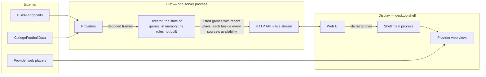

# Sportal — Technical Spec

> Architecture, physical layout, toolchain, and the designs behind them.
> Companion to [product-plan.md](./product-plan.md).

## 1. Architectural drivers

1. **Video is not ours.** Provider players are opaque, DRM-protected web pages. Sportal positions, tunes, and mutes them; it never touches the media. Everything about video goes through a narrow **Source** boundary.
2. **Data is unofficial.** Feeds can change shape without notice. Everything about game data goes through a narrow **Provider** boundary and is decoded on the way in.
3. **One Hub, many devices.** A desk display and a TV display must agree on the games, their scores, and where each can be streamed. Therefore that shared state lives in the Hub. Each Display owns its own Screen and applies its own commands.
4. **The Hub is portable.** It is a plain server process configured entirely by environment, keeping nothing between runs for now. Local today, cloud later, same code.
5. **The tracker stands alone.** Every feature except video playback works in any browser on any device.
6. **One definition per concept.** A domain concept is declared once, as an Effect Schema, and that one declaration serves as the type, the decoder, and the wire format.

## 2. Stack

### 2.1 The Rust and gpui question

You like Effect, Rust, and gpui. Only one of them fits this product cleanly, and it is worth saying why rather than quietly picking.

- **The shell must be Chromium.** Provider players need Widevine. On Linux, the system web view that Rust shells (Tauri, wry, and gpui's web-view component) use is WebKitGTK, which does not play Widevine content in practice. Chromium embedding from Rust exists but is immature. Electron with the castlabs Widevine build is the dependable path.
- **The UI must run on a phone and in a TV browser.** gpui renders natively on desktop only. A gpui UI would mean building the interface twice.
- **A Rust Hub is viable but splits the model.** The Hub could be Rust (axum, tokio, sqlx). It would be fast and pleasant, but every domain concept would then exist in two languages, kept in sync by code generation. That is exactly the type proliferation you want to avoid, bought for performance this workload (polling a few endpoints, pushing to a handful of clients) does not need.

**Decided: Effect TypeScript end to end** — one language, one schema per concept, shared verbatim by Hub, web UI, and shell.

### 2.2 Choices

Versions were checked against the registry on 2026-10-03. Effect is at 4.0, which merged the former platform packages into `effect` itself (`effect/http`, `effect/http-api`, `effect/sql`).

| Concern | Choice | Why |
| --- | --- | --- |
| Language | TypeScript 7 with the Effect language service (`@effect/tsgo`), `strict`, `noUncheckedIndexedAccess`, `exactOptionalPropertyTypes`, `erasableSyntaxOnly` | Shared model across every process. The language service's Effect diagnostics run in `tsc` and the editor. dependency-cruiser runs on a private TypeScript 6 until it supports 7.1. Erasable-only syntax lets Node run the Hub's source directly, with no build step |
| Core library | Effect 4 | Typed errors, dependency injection by Layer, schedules for polling, streams for live data, a test clock for replaying games |
| Schemas | Effect Schema | The single definition of each domain concept: type, decoder, encoder |
| HTTP API | Effect `HttpApi` (`effect/http-api`) | The API is declared once from domain schemas; the Hub implements it and clients derive a fully typed client from the same declaration — no hand-written request or response types anywhere |
| Live transport | Server-Sent Events carrying schema-encoded messages | One-way, auto-reconnecting, proxies and cloud hosts handle it without special setup |
| Persistence | None, for now | The Hub keeps nothing between runs: a restarted Hub starts from an empty slate and its next poll fills it. Persistence is added back on top of the simplified model (ADR 0012) |
| Runtime | Node 24 (LTS), pinned in `mise.toml` | Electron's main process is Node; one runtime everywhere |
| Package manager | pnpm workspaces | Strict dependency isolation; already installed |
| Web UI | React + Vite; TanStack Router once there is more than one screen | Components stay plain React; typed routes when routing exists |
| UI state | Server state mirrored from the Hub's live stream into one store; local-only state in component state | The Hub owns shared state, so the client has little of its own |
| Styling | Tailwind CSS with two density themes (desk, couch) | Same components, two presentation modes |
| Desktop shell | Electron (castlabs Widevine build), one `WebContentsView` per stream tile, electron-vite | The only dependable way to play Widevine content in several independent views |
| Telemetry | Effect's own OTLP exporters (`effect/observability`), over OTLP/HTTP to a collector named by `SPORTAL_OTLP_URL`; without it the Hub only logs to the console | Spans, logs, and metrics with no OpenTelemetry SDK and no new dependency; the provisioned Sportal folder contains Game Day, Game Detail, and Hub |
| Tests | Vitest with `@effect/vitest` | Effect-aware tests with a controllable clock |
| Lint and format | Biome | One fast tool |
| Structure enforcement | dependency-cruiser (import boundaries), knip (unused files, exports, dependencies) | The layout rules in section 4 are checked by machine, not by memory |
| Hooks | Lefthook: format and lint on commit; typecheck, test, structure checks on push | |
| Hub packaging (not built) | A container image built from `apps/hub` | The cloud move is "run the image with different environment" |

**Decided: no CI host yet.** The repository is local; the Lefthook hooks are the gate. CI is added when the repository gets a remote.

## 3. System shape



- **Hub** — takes what its providers' frames say, as they arrive, into the Director's slate (the listed games, each with its latest snapshot and plays), and will run its rules. Its live stream sends the slate, each game beside its availability from every source. Serves the web UI's static files, the HTTP API, and one live stream per client.
- **Web UI** — one codebase for desk and couch. It renders Hub state, and its Display owns its Screen: it applies screen commands and chooses between sources.
- **Desktop shell** — loads the web UI from the Hub, registers as a Display, and mirrors that Display's stream tiles into native provider web views. It is told the Hub's address by configuration (`SPORTAL_HUB_URL`, read once into `ShellConfig`) and never starts a Hub.

### 3.1 Why each Display owns its Screen

Each Display runs its own Screen, so a command costs no round trip and a second Display needs no keyed session on the Hub ([ADR 0015](./adr/0015-each-display-owns-its-screen.md)). The Hub publishes what every Display shares, and the Display does the rest:

```
command (from UI, hotkey, or palette)
  -> the Display's Screen applies it, against the availability each slate brought
  -> the new Screen is kept in the browser
  -> the Display's UI re-renders; the shell re-syncs its views
```

When automation is built, the Hub publishes a ranking of games by watchability, and each Display decides how its layout shows it. A stream budget shared across Displays will need the Hub's coordination.

### 3.2 How the shell treats provider players

- Provider pages load **unmodified** in a dedicated persistent session: no script injection, no preload, no request rewriting. The shell sets only a view's bounds, its address, and its mute flag.
- Score strips are drawn by the web UI *beside* each view, never over it, so nothing composites on top of protected video.
- Sign-in happens in the provider's own page. Sportal never sees or stores provider credentials.
- Navigation in provider views is restricted to an allowlist of provider and sign-in domains.

### 3.3 Portability and network exposure

- All Hub configuration comes from the environment through Effect `Config`: bind address, provider keys, access token.
- For now the Hub keeps no state between runs, so it can be stopped, moved, and restarted freely: its next poll fills the slate again.
- Planned: on the home network the Hub requires a single shared access token, entered once per device. It is not built for the public internet: a cloud deployment additionally requires real authentication, which is deliberately left as a future decision record rather than half-built now.
- The Electron shell never moves to the cloud; Displays always run at home and point at wherever the Hub is.

## 4. Physical layout and module standard

This section is binding in the same way the type checker is. `AGENTS.md` carries the rules that are easiest to break.

### 4.1 Principles

1. **A boundary must earn its place.** A workspace package exists only when two or more apps need the same code. A folder exists only when a concept has several files that belong to it and nothing else. Nothing is created for symmetry, for future use, or to look like an architecture.
2. **One concept, one home.** Every type, schema, and function has exactly one obvious file. If you cannot say which concept a file owns in one noun, the file is wrong.
3. **Name files for what they own.** A module is a file named for its concept — `Game.ts`, `Screen.ts`, `Director.ts` — exporting that concept's schema or class. Operations on a domain type are methods and statics of its class (`game.progress()`, `GameSnapshot.watchOrder`, `screen.apply(command, …)`), not loose functions beside it. The tree reads as a table of contents of the domain, and each type reads as the list of what it can do.
4. **No junk drawers.** These file and folder names are banned by lint: `utils`, `helpers`, `common`, `shared`, `misc`, `lib`, `types`, `constants`, `models`, `interfaces`. A function that seems to belong in one belongs with the concept it operates on; if it operates on none, it is probably already in Effect.
5. **No barrels.** No `index.ts` re-export files. Packages expose modules through `package.json` `exports`; inside an app, import the module file directly.
6. **No mirror types.** There is no `GameDto`, `GameRow`, `GameResponse`, `GameProps`. The domain schema is the wire format. A variant is derived from the original (`pick`, `omit`, `extend`) at the point of use and is not given a name unless it is itself a domain concept with a glossary entry.
7. **Search before you write.** Before adding a function, type, or file, look for the existing one. Duplicating logic that already exists is a defect even when the code works.
8. **Organize by concept, not by kind.** No top-level `components/`, `hooks/`, `services/`, `schemas/` folders. Code for the slate lives under `slate/`, whatever kind of code it is.
9. **Dependencies point one way.** `domain` imports only Effect. `api` imports `domain`. Apps import packages. Nothing imports an app. Within the Hub, ESPN's layers are reached only through `provider/espn/Espn.ts`.

### 4.2 The tree

Two packages and three apps. Providers, sources, and the Director are used only by the Hub, so they are modules of the Hub, not packages.

```
sportal/
├── AGENTS.md                   Rules for coding agents that are easiest to break
├── CLAUDE.md                   One line: read AGENTS.md
├── CONTEXT.md                  Domain language: built terms, then the planned ones
├── mise.toml                   Pinned Node and pnpm
├── package.json                Workspace scripts: check, test, dev
├── pnpm-workspace.yaml
├── tsconfig.base.json
├── biome.json
├── knip.json
├── vitest.config.ts            Vitest projects and coverage; each workspace has its own vitest.config.ts
├── .dependency-cruiser.cjs     Import-direction and banned-name rules
├── lefthook.yml
├── telemetry/                  Local Grafana: compose file, Game Day, Game Detail, and Hub dashboards
│
├── docs/
│   ├── product-plan.md
│   ├── technical-spec.md
│   ├── game-day-checklist.md   What only a live game day can verify
│   ├── history.md              The shipped pieces, and where their old plans live in git
│   ├── adr/                    One short file per hard-to-reverse decision
│   ├── specs/                  Designs not yet built, and the cleanup's
│   └── plans/                  The cleanup's plan
│
├── packages/
│   ├── domain/                 Pure. Imports only Effect. No I/O.
│   │   └── src/
│   │       ├── League.ts       LeagueId
│   │       ├── Team.ts         Team, its colors, Ranking
│   │       ├── Game.ts         Game (a snapshot and its plays), GameId, GameStatus, GameSnapshot, BallSpot, Network, Broadcast
│   │       ├── Slate.ts        Slate (the listed games, from listings and play lists), SlateChange
│   │       ├── Situation.ts    Possession, down, distance, field position, red zone
│   │       ├── Play.ts         A single play, as the game's play-by-play lists it; PlayKind
│   │       ├── Channel.ts      SourceName, Channel, ChannelAvailability
│   │       ├── Stream.ts       StreamLocator
│   │       └── TestGame.ts     Game snapshots and plays for tests
│   │
│   └── api/                    The contracts between processes.
│       └── src/
│           ├── SportalApi.ts       HttpApi declaration: endpoint groups built from domain schemas
│           ├── GuideUnreadable.ts  The error for a guide response the source could not read
│           ├── LiveMessage.ts      The union of messages on the live stream
│           ├── ShellBridge.ts      What the desktop shell exposes to the web UI; TilePlacement, TileBounds
│           ├── ShellChannel.ts     The IPC channel names, apart so the sandboxed preload bundles only them
│           └── Hotkey.ts           The keys Sportal acts on, with their help text
│
└── apps/
    ├── hub/
    │   └── src/
    │       ├── main.ts             Composition root: the Hub's layer pipe, run until a signal stops it; the only file that chooses providers and sources, ESPN's through `Espn`
    │       ├── HubConfig.ts        Every environment setting, in one place
    │       ├── Telemetry.ts        Log level and format; OTLP export when configured
    │       ├── Director.ts         The one holder of the slate: takes each frame's deliveries as they arrive and offers the slate
    │       ├── HubStopping.ts      Whether a task that should run until the Hub stops ended because it is stopping, and the Error log unless it did
    │       ├── TestTelemetry.ts    Layers for tests
    │       ├── TestDirector.ts     The Director taking a fed provider, and what it takes of a test's frames
    │       ├── TestHubServer.ts    The Hub's routes served on an ephemeral port with a client, the live stream read as messages, and what a test publishes into it
    │       ├── HubServer.ts        Serves the API, the live stream, and the web UI's files
    │       ├── provider/
    │       │   ├── Provider.ts     The port: `deliveries`, each frame's in order, and `Delivery`, what a frame said; `layerTest`, the provider tests feed
    │       │   ├── ProviderFeed.ts How a test drives `Provider.layerTest`: `deliver` a frame's deliveries, `end` the frames
    │       │   ├── TestProvider.ts The games the provided `Provider` first lists for a league
    │       │   └── espn/
    │       │       ├── Espn.ts             ESPN's one front door: the live provider (`layer`), polling and pushing through FastCast
    │       │       ├── EspnProvider.ts     Implements the port: polls each league on its own, folds FastCast's frames into GameTopics, tells FastCast what to follow
    │       │       ├── GameTopics.ts       The fold of FastCast's frames: each game topic's document and its decoded plays
    │       │       ├── EspnPayload.ts      ESPN's JSON as ESPN spells it: events, scoreboard, plays
    │       │       ├── EspnEvent.ts        The site scoreboard's event as a GameSnapshot
    │       │       ├── EspnPlay.ts         ESPN's plays and their type ids, as Play
    │       │       ├── FastCast.ts         ESPN's push, a service: follows the topics it is told to, and gives the socket as frames
    │       │       ├── FastCastDocuments.ts Each topic's document, rebuilt from checkpoints and patches, and what a frame changed of it
    │       │       ├── FastCastMessage.ts  FastCast's wire shapes: the outer envelope, framing, and the patch message
    │       │       ├── Topic.ts            A FastCast topic, read once from its `tc`
    │       │       ├── Frame.ts            A frame as received, before ESPN's decode reads it
    │       │       ├── TestEspn.ts         Recorded payloads, NE at BUF's day replayed and cached (`recordedNeAtBuf`, `neAtBufDecoded`), and ESPN answering from recorded scoreboards (`recordedEspn`)
    │       │       ├── TestFastCast.ts     A fake FastCast socket host, builders of frames, checkpoints and messages, and the real FastCast run over the fake host (`nflFrames`, `framesOver`, `closedSockets`)
    │       │       ├── TestGameTopics.ts   A test's frames replayed through the game topics, and the topics they leave
    │       │       └── fixtures/           Recorded real payloads, NE at BUF's frames among them
    │       └── source/
    │           ├── Source.ts           The port, its variants, and how several act as one
    │           ├── Guide.ts            Guide, Airing, ChannelId: a source's channels and what each airs
    │           ├── Twitch.ts           Twitch's lineup
    │           ├── TestSource.ts       The source's availability now, for tests
    │           ├── TestGuide.ts        Guides and airings for tests
    │           └── youtube-tv/
    │               ├── YouTubeTv.ts         Reads the guide the shell fetches, offers it while fresh
    │               ├── YouTubeTvGuide.ts    A guide response decoded to a complete, validated, stamped Guide
    │               ├── YouTubeTvPayload.ts  The guide response's wire shape
    │               ├── TestYouTubeTv.ts     A recorded guide, and a response of one row, for tests
    │               └── fixtures/            Recorded real payloads
    │
    ├── web/
    │   └── src/
    │       ├── main.tsx
    │       ├── theme.css           Desk and couch density themes
    │       ├── design/             Vendored shadcn primitives, under the CLI's own file names
    │       ├── display/            This device's Display: state and rules, hotkeys, full screen, overlays, top bar, command palette
    │       ├── hub/                HubClient (typed client from SportalApi), LiveStream (the live stream, as an atom), HubRuntime
    │       ├── slate/              The slate strip and its cards
    │       ├── screen/             The Screen (state, commands, source choice), this Display's copy of it, tiles, dividers, tile actions, rejections
    │       ├── layout/             Layout (the geometry: slots, dividers, next, clamp), its picker and glyphs
    │       ├── game/               A game's status, score, and logo, as slate and tiles show them; the field, which draws a game's plays
    │
    └── desktop/
        └── src/
            ├── main/
            │   ├── main.ts             App lifecycle: the shell's layers, and the window's IPC
            │   ├── ShellConfig.ts      Every setting the shell reads from its environment: the Hub's address
            │   ├── ShellWindow.ts      The shell's one window, confined to the Hub's origin
            │   ├── TileViews.ts        Creates, positions, tunes, and mutes provider views
            │   ├── Transition.ts       The arithmetic of a Screen transition
            │   ├── GuideReader.ts      Reads the source's guide with its own request
            │   ├── ProviderSession.ts  The persistent session and its permissions
            │   ├── Navigation.ts       Keeps a page on the addresses allowed
            │   ├── Sandbox.ts          What every window and view runs under
            │   ├── YouTubeTv.ts        YouTube TV's sign-in address, hosts, and origin
            │   └── Twitch.ts           Twitch's player host
            └── preload/
                └── ShellBridge.ts      Implements the shell bridge declared in packages/api
```

Tests sit beside the file they test as `Game.test.ts`. A module grows into a folder of the same name only when it genuinely has private parts, as `provider/espn/` does. Regenerate this tree from `git ls-files` when the layout changes.

**Not built:** domain `Follow.ts`, `Rule.ts`; hub `Dockerfile`, `provider/cfbd/`, `director/`, and stores for follows, presets, and rules; web `settings/` and a game's detail view. The Director, follows, presets, rules, the spoiler shield, and cloud hosting in the sections below are designs, not code.

### 4.3 Inside a file

The same standard applies within a file as across the tree: a file is not a junk drawer either. Someone opens `Director.ts` to read how the Director takes its provider's frames and publishes the slate, and that is what they should see first.

1. **The main thing comes first.** A file leads with the concept it is named for — the schema, the service, the component. A reader should reach the main behaviour without scrolling past anything.
2. **Supporting code goes below, not above.** Private helpers are written as hoisted `function` declarations beneath the code that uses them, in the order they are first used. No stack of small helpers piled on top of the thing the file exists for.
3. **A helper must earn a name.** If it is used once and is a few lines, inline it. If it is really an operation on another concept, it belongs on that concept's type (`game.progress()`, not a local `gameProgress`). If Effect already has it, use Effect's.
4. **No incidental types.** Do not declare an interface or type alias for an options bag, a return shape, a callback, or a component's props that is used in one place — write the shape inline in the signature. A named type appears in a file only when it is that file's concept or a glossary term that lives there.
5. **A service reads as its behaviour.** A service file is: the service declaration (its interface is the one type in the file), then the Layer that implements it, then private helpers. Not a preamble of types and constants followed, eventually, by the logic.
6. **Constants live with their only user.** A value used by one function is declared in or directly beneath that function, not gathered at the top of the file.
7. **When a file needs a table of contents, split it** — by concept, into a folder of the same name, never into `FooTypes.ts` and `FooHelpers.ts`.

### 4.4 What gets checked automatically

| Rule | Tool |
| --- | --- |
| Import direction (section 4.1, rule 9); provider folders private to themselves | dependency-cruiser |
| Production code cannot import a Hub `Test*.ts`; tests and other Hub `Test*.ts` harnesses can | dependency-cruiser |
| Banned file and folder names; no `index.ts` barrels | dependency-cruiser |
| No unused files, exports, or dependencies | knip |
| No `any`, no non-null assertions, no default exports | Biome |

Rules 2, 6, and 7 of section 4.1 and all of section 4.3 need judgement and are review criteria. Every review asks three questions: does this duplicate something that exists; does every new type name appear in the glossary; and does each touched file still open on its main behaviour?

## 5. Key designs

### 5.1 Ports

Ports are Effect services; implementations are Layers; `main.ts` wires them. Signatures are indicative.

**Provider** — game data in, as each frame's deliveries:

```ts
class Provider extends Context.Service<Provider, {
  readonly deliveries: Stream<ReadonlyArray<Delivery>>   // what each frame it receives said, in order received; never fails
}>()("sportal/hub/provider/Provider") {}
```

- A provider runs itself. It polls, follows its push, reconnects, and reads each frame it receives with its own decode, for as long as it runs; nothing tells it what to do. Its failures are logged and counted inside its folder, where they happen.
- Each element is one frame's `Delivery`s (`Listing` or `Plays`), in the order it said them. ESPN's poll (`EspnEvent.listingOf`) skips an event that does not decode and lists the rest; its fold of FastCast's frames (`GameTopics#take`) does the same for a play. A poll or a frame that does not decode says nothing and is a Warning log. `Provider.layerTest` is the provider tests feed: its frames say our own deliveries, given through `ProviderFeed` (`provider/ProviderFeed.ts`), until it ends them.
- ESPN's cadence is each league's own poll loop in `EspnProvider`: each league waits after its poll by its own last good listing: about every 10 seconds while one is live, every minute near kickoff, every 15 minutes otherwise, at most 30 seconds after a poll that failed or did not decode (a successful empty listing is not a failure). The polls and FastCast's game topics run beside each other, with no order between them: they never say the same facts. After each listing, `GameTopics#retainedFor` keeps documents and decoded plays only for the topics still wanted; a push or checkpoint prunes nothing. FastCast (`docs/adr/0007-fastcast-live-feed.md`, `docs/adr/0016-espns-poll-lists-its-game-topics-play.md`) is the service its push reads from: it follows the topics `EspnProvider` names from each league's last good listing (each listed game live or near kickoff, `Topic.wantedAt`), follows a topic again when its document goes back to waiting for its checkpoint, and retries its socket on a jittered exponential backoff. FastCast parses each socket text once, into its envelope (`FastCastMessage.Envelope`), and reads only the framing it needs from it (op, topic, mid, an `H`'s checkpoint URL); `FastCastDocuments` validates and decodes the patch message, payload and all, from that same envelope, so framing and patch validation stay distinct steps.
- Provider vocabulary stops at the folder edge. ESPN's "event", "competition", and "competitor" exist only in `EspnPayload.ts`, `EspnEvent.ts`, `FastCastMessage.ts`, and `EspnPlay.ts`.
- The Hub composes providers per league: ESPN for NFL; ESPN with CollegeFootballData filling gaps for FBS. The composition is itself a `Provider`, so the Director sees one.
- Each adapter's tests are "this recorded frame decodes to this delivery".

**Director** — the one holder of the day's slate, between the provider and everything that reads games. Not a port: one implementation (`docs/adr/0009-one-fold-not-actors.md`, amended by
[ADR 0012](./adr/0012-no-persistence-one-take.md)):

```ts
class Director extends Context.Service<Director, {
  readonly slate: Stream<Slate>                      // the slate as it is, then each change
}>()("sportal/hub/Director") {}
```

- The `Slate` (`packages/domain/src/Slate.ts`) is the fold: an ordered list of `Game`s, leagues in `LeagueId` order and each league's in its listing's order, each with its latest `GameSnapshot` and its plays. `relisted(league, snapshots)` and `playsTaken(game, plays)` on it are pure and return the next slate and its slate changes; one that changes nothing gives back the same slate. The Director takes each frame's deliveries onto them in order.
- The Director starts from an empty slate and takes each frame's deliveries as they arrive, in one `Director.take` span carrying its `sportal.deliveries` count. From the slate changes each take gives, it gauges each listed game's progress (`sportal_game_state`: 1 upcoming, 2 live, 3 over), status (`sportal_game_status`: 1 scheduled, 2 live, 3 halftime, 4 delayed, 5 final, 6 postponed, 7 canceled), away and home scores (`sportal_game_score`), period (`sportal_game_period`), clock (`sportal_game_clock`), kickoff as Unix seconds (`sportal_game_kickoff`), and accepted-at time as Unix seconds (`sportal_game_updated_at`). Every series carries stable `game`, `league`, and `matchup` attributes; score series also carry `side` and `team`. A changing value updates its series, and a game no listing names has every current-game series removed. The Director logs each play a take adds at Info, annotated with `game`, `league`, `matchup`, `play`, and `scoring`; these logs, rather than a play counter, supply the latest-five, scoring-only, and complete-in-range play panels. For now nothing is kept between runs: a restarted Hub serves an empty slate until its provider's next poll lists the day's games.
- A take that raises a defect is an Error log; the slate keeps what it had and takes the next frame. If the provider's frames end other than by the Hub stopping, that is an Error log and the slate stays as it is.
- The Hub server's live route builds `SlateChanged`: the slate with each game carrying only its last ten plays (`Slate#recent`), and each listed game's availability from every source, by its id. The Slate and the Director know nothing of sources or the API: the live route joins the Director's slate with the source's availability, drops a message that is the same as the last, and sends it once 250 ms have passed without a further change to the slate or to a source (a trailing settling, not a maximum latency: continuous updates keep deferring it).
- `main.ts` provides it over ESPN as the provider and YouTube TV and Twitch as the sources.
- The Hub's whole shutdown bound is about 4 s: the HTTP server's 3 s for connected Displays, then telemetry's 1 s to export what it holds.

**Source** — video out:

```ts
class Source extends Context.Service<Source, {
  // as it is, then again each time what the source knows changes: a guide read, or a guide gone stale
  readonly availability: Stream<(game: GameSnapshot, now: DateTime.Utc) => ReadonlyArray<ChannelAvailability>>
}>()("sportal/hub/source/Source") {}
```

`Source.layerAll` runs every source and gives each game's availability from every source, in the order the sources are given, again whenever any of them changes; it merges nothing. A matched channel on the air is carried once the slate says the game has started, and upcoming before, so nothing ticks: the live route reads the time when it sends, only to choose among a guide's airings. The Display's Screen chooses: the most useful availability (carried, upcoming, no guide, then not carried), and a stream tile moves only when its own source carries its game on another channel, so a tile never moves to another source. YouTube TV's availability comes from the latest guide it read; Twitch's from its lineup, a guide whose one channel carries Prime Video, given once.

YouTube TV's channels are found in its own guide, read by the shell and handed to `Source.readGuide`, which every source receives and only YouTube TV keeps (`docs/history.md`, "Guide-matched channels"); with no fresh guide (a guide is fresh for 45 minutes), its availability is "no guide". Twitch's lineup is fixed and never read.

`StreamLocator` is a tagged union. Today it has one member, a web-view address; a new kind is added only when a source needs it.

**Stores** — none, for now. The Hub keeps nothing between runs ([ADR 0012](./adr/0012-no-persistence-one-take.md)); persistence is added back on top of the simplified model. A Screen is kept only in its Display's browser.

### 5.2 Frames and deliveries

- Polling is the provider's own: each league polls about every 10 seconds while one of its games is live, every minute near kickoff, every 15 minutes otherwise. One slate request per league covers every game; detail is fetched only for games someone has open.
- A college Saturday is one request for 50+ games, not 50 requests.
- The provider decodes its own frames; the Director takes each frame's deliveries as they arrive, in the order the provider received its frames. Nothing is logged raw or replayed.
- The live feed pushes, for each followed game, its plays; no score is pushed, so a live score moves with the poll. The poll gives listings: a listing takes each of its games as a snapshot and forgets the league's games it no longer names. A listed game takes a snapshot unless it is behind the game (`Game#snapshotTaken`, `GameSnapshot#isBehind`): earlier in game time, or at the same game time with fewer points; an over game takes one ahead of its end (overtime after a spurious final, a postponed game resuming), so a lagging poll cannot start a finished game again.
- A FastCast topic that loses its document (a missed message, a patch that will not apply) is a Warning log from `GameTopics`, and the push follows the topic again from its checkpoint. A checkpoint that does not load or decode is a Warning log, and FastCast subscribes to its topic again after 30 s while it is still wanted, unless a later checkpoint of that topic succeeds first. FastCast loads up to four checkpoints at once, but emits frames and applies each checkpoint's outcome (a failure's wait, a success's cancelling it) in the order the socket sent them.
- Game events are gone: nothing read them (ADR 0012). The Director's rules will derive them again from snapshot changes and plays when they are built.
- The slate's games and plays are the latest the feeds gave; a missed poll is filled by the next one, and a restart starts from empty until persistence is added back (ADR 0012).

### 5.3 Screen

`screen.apply(command, availabilityOf)` (`apps/web/src/screen/Screen.ts`) is a pure method returning the new Screen or a typed rejection; `availabilityOf` gives every source's answer for a game.

- State: a layout (`Single`, `Pair`, `Quad`, `MainThree`, `MainFive`), each layout's split, the tiles (each empty, stream, or data), audio focus, and solo. The first `Screen.slotCount(layout)` tiles are on screen, main tile first; the rest are the **bench**, kept in order and not played. Audio focus and solo name a game, so they follow it when tiles move.
- Commands: `Assign`, `Clear`, `Swap`, `Promote`, `SetLayout`, `SetSplit`, `Solo`, `Unsolo`, `FocusAudio`. `LoadPreset` comes with presets.
- Invariants, enforced only here: a game appears in at most one tile, on screen or benched; audio focus is an on-screen game (the focused one while it is on screen, else the first), or none on an empty screen; solo is an on-screen game; dividers stay within 0.2–0.8. A stream budget per source across **all** Displays is not a Screen invariant and is not enforced here: keeping every Display's stream tiles within a source's budget will need the Hub's coordination ([ADR 0015](./adr/0015-each-display-owns-its-screen.md)).
- Geometry: the web's `Layout#slots` gives each slot as fractions of the Screen area. The web UI turns them into pixels once and uses the same numbers for its tile chrome and the shell's tile placements, so the two move together along one **Screen transition** (280 ms, `cubic-bezier(0.2, 0, 0, 1)`), which the shell follows by moving each view's bounds.
- Full screen is the Display's window, local to it, and is not Screen state.

Each Display owns its Screen (`DisplayScreen.ts`, an atom kept in localStorage). A screen command written to it is applied against the availability the latest slate brought, and a refused one is published on its `rejected` atom. Each slate from the live stream refreshes its tiles with `screen.refresh`. The Hub holds no Screen.

### 5.4 Director

Designed in full in `docs/specs/2026-10-03-director-design.md`.

- What makes a game worth watching is still to be designed again: the first watchability score is gone, and the
  Director's rules read game events and plays.
- Automation is planned: a **Trigger** is a condition over events and snapshots, and a **Rule** will move games in a ranking by watchability, never send a screen command.
- The Director runs in the Hub, so it works with no client focused. It will publish a ranking of games, and each Display will decide how its layout shows it ([ADR 0015](./adr/0015-each-display-owns-its-screen.md)).
- A Display will hold off following the ranking on a tile a person just changed.

### 5.5 Time and the spoiler shield

- Time comes only from Effect's `Clock`. Tests use the test clock to replay a recorded game at any speed.
- Each stream tile has a tile delay. The Hub's live stream is immediate; the *client* holds back score data for that game by the delay, so different Displays can have different delays for the same game.

### 5.6 Failure behaviour

Expected failures are typed errors in the Effect error channel, each handled where it can be handled meaningfully.

| Failure | Behaviour |
| --- | --- |
| Provider unreachable, refused, or stalled | A poll's request and body read are bounded to 20 s; a stall is a failed poll. Logged as a Warning, annotated with its league; the slate keeps each game's last snapshot; that league is polled again 30 s after the failure is folded (10 s while a game is live) |
| Payload fails to decode | Skip that game or play and deliver the rest; a frame that does not decode says nothing and is a Warning log |
| Stream view fails to load | Tile becomes a data tile with a retry action |
| Over budget | Assignment becomes a data tile; the UI says why |
| Client loses the Hub | UI shows disconnected and reconnects; provider views keep playing |
| Live feed refused, closed, silent, or out of step | Logged as a Warning with its reason; resubscribed from a checkpoint with backoff from 1 s to 1 min; the poll carries on, so games go on updating at the poll's pace |
| Applying a delivery dies | Error log; the slate keeps what it had and takes the next frame |
| Telemetry collector unreachable | One warning naming its URL; the exporters drop what they cannot send and the Hub carries on, and still stops within its shutdown bound |

The `sportal_hub_up` gauge is 1 while the Hub telemetry registry is active, so the dashboards distinguish a healthy Hub with an empty slate from an unavailable Hub whose series is absent after Prometheus staleness.

## 6. Domain language

[`CONTEXT.md`](../CONTEXT.md) holds the glossary: built terms first, planned ones after. Every exported type name must be a term there.

## 7. Coding practices

[`AGENTS.md`](../AGENTS.md) holds the rules for how code is written, tested, and committed. Section 4 above says where code goes.

## 8. History

What shipped, in what order, the finished spikes, and the early decisions are in [`history.md`](./history.md). Old plans and designs are read from git, at the commit it names.
