# Sportal — Technical Spec

> Architecture, physical layout, toolchain, and the designs behind them.
> Companion to [product-plan.md](./product-plan.md).

## 1. Architectural drivers

1. **Video is not ours.** Provider players are opaque, DRM-protected web pages. Sportal positions, tunes, and mutes them; it never touches the media. Everything about video goes through a narrow **Source** boundary.
2. **Data is unofficial.** Feeds can change shape without notice. Everything about game data goes through a narrow **Provider** boundary and is decoded on the way in.
3. **One Hub, many devices.** A desk display, a TV display, and a phone remote must agree on what is on screen. Therefore all shared state — games, follows, and the state of every Stage — lives in the Hub. Clients render and send commands.
4. **The Hub is portable.** It is a plain server process configured entirely by environment, with storage behind a port. Local today, cloud later, same code.
5. **The tracker stands alone.** Every feature except video playback works in any browser on any device.
6. **One definition per concept.** A domain concept is declared once, as an Effect Schema, and that one declaration serves as the type, the decoder, the wire format, and the storage codec.

## 2. Stack

### 2.1 The Rust and gpui question

You like Effect, Rust, and gpui. Only one of them fits this product cleanly, and it is worth saying why rather than quietly picking.

- **The shell must be Chromium.** Provider players need Widevine. On Linux, the system web view that Rust shells (Tauri, wry, and gpui's web-view component) use is WebKitGTK, which does not play Widevine content in practice. Chromium embedding from Rust exists but is immature. Electron with the castlabs Widevine build is the dependable path.
- **The UI must run on a phone and in a TV browser.** gpui renders natively on desktop only. A gpui UI would mean building the interface twice.
- **A Rust Hub is viable but splits the model.** The Hub could be Rust (axum, tokio, sqlx). It would be fast and pleasant, but every domain concept would then exist in two languages, kept in sync by code generation. That is exactly the type proliferation you want to avoid, bought for performance this workload (polling a few endpoints, pushing to a handful of clients) does not need.

**Decided: Effect TypeScript end to end** — one language, one schema per concept, shared verbatim by Hub, web UI, and shell.

### 2.2 Choices

Versions were checked against the registry on 2026-10-03. Effect is at 4.0, which folded the former platform packages into `effect` itself (`effect/http`, `effect/http-api`, `effect/sql`).

| Concern | Choice | Why |
| --- | --- | --- |
| Language | TypeScript 6, `strict`, `noUncheckedIndexedAccess`, `exactOptionalPropertyTypes`, `erasableSyntaxOnly` | Shared model across every process. Not TypeScript 7 yet: dependency-cruiser does not support it. Erasable-only syntax lets Node run the Hub's source directly, with no build step |
| Core library | Effect 4 | Typed errors, dependency injection by Layer, schedules for polling, streams for live data, a test clock for replaying games |
| Schemas | Effect Schema | The single definition of each domain concept: type, decoder, encoder |
| HTTP API | Effect `HttpApi` (`effect/http-api`) | The API is declared once from domain schemas; the Hub implements it and clients derive a fully typed client from the same declaration — no hand-written request or response types anywhere |
| Live transport | Server-Sent Events carrying schema-encoded messages | One-way, auto-reconnecting, proxies and cloud hosts handle it without special setup |
| Persistence | Effect SQL: SQLite locally, Postgres when cloud-hosted | Same repository code against either; chosen by configuration |
| Runtime | Node 24 (LTS), pinned in `mise.toml` | Electron's main process is Node; one runtime everywhere |
| Package manager | pnpm workspaces | Strict dependency isolation; already installed |
| Web UI | React + Vite; TanStack Router once there is more than one screen | Components stay plain React; typed routes when routing exists |
| UI state | Server state mirrored from the Hub's live stream into one store; local-only state in component state | The Hub owns shared state, so the client has little of its own |
| Styling | Tailwind CSS with two density themes (desk, couch) | Same components, two presentation modes |
| Desktop shell | Electron (castlabs Widevine build), one `WebContentsView` per stream tile, electron-vite | The only dependable way to play Widevine content in several independent views |
| Telemetry | Effect's own OTLP exporters (`effect/observability`), over OTLP/HTTP to a collector named by `SPORTAL_OTLP_URL`; without it the Hub only logs to the console | Spans, logs, and metrics with no OpenTelemetry SDK and no new dependency |
| Tests | Vitest with `@effect/vitest`; Playwright for the web UI | Effect-aware tests with a controllable clock |
| Lint and format | Biome | One fast tool |
| Structure enforcement | dependency-cruiser (import boundaries), knip (unused files, exports, dependencies) | The layout rules in section 4 are checked by machine, not by memory |
| Hooks | Lefthook: format and lint on commit; typecheck, test, structure checks on push | |
| Hub packaging (not built) | A container image built from `apps/hub` | The cloud move is "run the image with different environment" |

**Decided: no CI host yet.** The repository is local; the Lefthook hooks are the gate. CI is added when the repository gets a remote.

## 3. System shape

```mermaid
flowchart LR
  subgraph ext[External]
    espn[ESPN endpoints]
    cfbd[CollegeFootballData]
    yttv[Provider web players]
  end

  subgraph hub[Hub — one server process]
    prov[Providers]
    ingest[Ingest: poll, live feed, replay]
    feedlog[(Feed log: feed.sqlite)]
    decode[Provider.decode: frames to deliveries]
    fold[LiveGames: one fold, every game's state and plays]
    history[(GameHistory: plays, latest snapshots)]
    slate[Slate: listed games, as the fold has them]
    director[Director: rules over game events and plays, not built]
    stages[Stage sessions: the one Stage, in memory]
    store[(SQL store)]
    api[HTTP API + live stream]
  end

  subgraph display[Display — desktop shell]
    ui1[Web UI]
    main[Shell main process]
    views[Provider web views]
  end

  subgraph remote[Remote — phone or browser]
    ui2[Web UI]
  end

  espn --> prov
  cfbd --> prov
  prov -- frames --> ingest
  ingest -- every frame, raw --> feedlog
  feedlog -- frames in seq order --> decode
  prov --> decode
  decode -- deliveries --> fold
  fold -- live games, for the polling Schedule and the live feed --> ingest
  fold -- changes --> history --> store
  fold -- live games, listings --> slate
  fold -- game events --> director
  director -- stage commands --> stages
  api <--> ui1
  api <--> ui2
  slate --> api
  stages --> api
  ui1 -- tile rectangles --> main --> views
  yttv --> views
```



- **Hub** — polls providers and follows their live feeds, appends every frame to the feed log, folds what the frames say into each game's plays and state (deriving its game events), runs the Director, and holds the authoritative **Stage** in memory (one, until a second Display needs its own). Serves the web UI's static files, the HTTP API, and one live stream per client.
- **Web UI** — one codebase for desk, couch, and phone. It renders Hub state and sends commands. It contains no business rules.
- **Desktop shell** — loads the web UI from the Hub, registers as a Display, and mirrors that Display's stream tiles into native provider web views. It is told the Hub's address by configuration (`SPORTAL_HUB_URL`) and never starts a Hub.

### 3.1 Why Stage state lives in the Hub

The phone must be able to change what the TV shows, and the Director must be able to promote a game while no one is touching anything. If each client owned its Stage, both would need client-to-client messaging. With the Hub as owner there is one path for everyone:

```
command (from UI, remote, hotkey, or Director)
  -> Hub applies it to the pure Stage state machine
  -> new Stage state is stored and broadcast
  -> the Display's UI re-renders; the shell re-syncs its views
```

On a local network the round trip is a few milliseconds. If a cloud-hosted Hub ever makes it noticeable, the client can apply the same pure function optimistically — the function is in the shared package for that reason.

### 3.2 How the shell treats provider players

- Provider pages load **unmodified** in a dedicated persistent session: no script injection, no preload, no request rewriting. The shell sets only a view's bounds, its address, and its mute flag.
- Score strips are drawn by the web UI *beside* each view, never over it, so nothing composites on top of protected video.
- Sign-in happens in the provider's own page. Sportal never sees or stores provider credentials.
- Navigation in provider views is restricted to an allowlist of provider and sign-in domains.

### 3.3 Portability and network exposure

- All Hub configuration comes from the environment through Effect `Config`: bind address, storage address, provider keys, access token.
- The Hub keeps no state outside its data directory (`sportal.sqlite` and `feed.sqlite`), so it can be stopped, moved, and restarted freely.
- Planned: on the home network the Hub requires a single shared access token, entered once per device. It is not built for the public internet: a cloud deployment additionally requires real authentication, which is deliberately left as a future decision record rather than half-built now.
- The Electron shell never moves to the cloud; Displays always run at home and point at wherever the Hub is.

## 4. Physical layout and module standard

This section is binding in the same way the type checker is. `AGENTS.md` carries the rules that are easiest to break.

### 4.1 Principles

1. **A boundary must earn its place.** A workspace package exists only when two or more apps need the same code. A folder exists only when a concept has several files that belong to it and nothing else. Nothing is created for symmetry, for future use, or to look like an architecture.
2. **One concept, one home.** Every type, schema, and function has exactly one obvious file. If you cannot say which concept a file owns in one noun, the file is wrong.
3. **Name files for what they own.** A module is a file named for its concept — `Game.ts`, `Stage.ts`, `Ingest.ts` — exporting that concept's schema or class. Operations on a domain type are methods and statics of its class (`game.progress()`, `GameSnapshot.watchOrder`, `stage.apply(command, …)`), not loose functions beside it. The tree reads as a table of contents of the domain, and each type reads as the list of what it can do.
4. **No junk drawers.** These file and folder names are banned by lint: `utils`, `helpers`, `common`, `shared`, `misc`, `lib`, `types`, `constants`, `models`, `interfaces`. A function that seems to belong in one belongs with the concept it operates on; if it operates on none, it is probably already in Effect.
5. **No barrels.** No `index.ts` re-export files. Packages expose modules through `package.json` `exports`; inside an app, import the module file directly.
6. **No mirror types.** There is no `GameDto`, `GameRow`, `GameResponse`, `GameProps`. The domain schema is the wire format and the stored format. A variant is derived from the original (`pick`, `omit`, `extend`) at the point of use and is not given a name unless it is itself a domain concept with a glossary entry.
7. **Search before you write.** Before adding a function, type, or file, look for the existing one. Duplicating logic that already exists is a defect even when the code works.
8. **Organize by concept, not by kind.** No top-level `components/`, `hooks/`, `services/`, `schemas/` folders. Code for the slate lives under `slate/`, whatever kind of code it is.
9. **Dependencies point one way.** `domain` imports only Effect. `api` imports `domain`. Apps import packages. Nothing imports an app. Within the Hub, only `HubMode.ts` knows which concrete providers and sources exist.

### 4.2 The tree

Two packages and three apps. Providers, sources, ingest, and the Director are used only by the Hub, so they are modules of the Hub, not packages.

```
sportal/
├── AGENTS.md                   Rules for coding agents that are easiest to break
├── CLAUDE.md                   One line: read AGENTS.md
├── CONTEXT.md                  Domain language: built terms, then the planned ones
├── mise.toml                   Pinned Node and pnpm
├── package.json                Workspace scripts: check, test, dev
├── pnpm-workspace.yaml
├── tsconfig.base.json
├── biome.json
├── knip.json
├── vitest.config.ts
├── .dependency-cruiser.cjs     Import-direction and banned-name rules
├── lefthook.yml
├── fixtures/scenarios/         Recorded scenarios: raw frames of recorded game-day windows (and, until they go, their JSON slices)
├── telemetry/                  Local Grafana: compose file and the Hub's dashboards
│
├── docs/
│   ├── product-plan.md
│   ├── technical-spec.md
│   ├── game-day-checklist.md   What only a live game day can verify
│   ├── history.md              The shipped pieces, and where their old plans live in git
│   ├── adr/                    One short file per hard-to-reverse decision
│   ├── specs/                  Designs not yet built, and the cleanup's
│   └── plans/                  The cleanup's plan
│
├── packages/
│   ├── domain/                 Pure. Imports only Effect. No I/O.
│   │   └── src/
│   │       ├── League.ts       LeagueId
│   │       ├── Team.ts         Team, Ranking
│   │       ├── Game.ts         GameId, GameStatus, GameSnapshot, Network, Broadcast
│   │       ├── Situation.ts    Possession, down, distance, field position, red zone
│   │       ├── Play.ts         A single play, as the game's play-by-play lists it; PlayKind
│   │       ├── GameEvent.ts    The event union, derived from plays or from two snapshots
│   │       ├── Delivery.ts     What a frame said: a listing, a snapshot, or a game's plays; DeliverySource
│   │       ├── LiveGame.ts     One game as the Hub follows it: LiveGame, LiveGameState; take and tick
│   │       ├── LiveGames.ts    The pure fold of every delivery in order; FoldReport
│   │       ├── Channel.ts      SourceName, Channel, ChannelCarriage, ChannelLineup, ChannelAvailability, ChannelUrlRefused
│   │       ├── Guide.ts        Guide, Airing, ChannelId, GuideUnreadable
│   │       ├── Stream.ts       StreamLocator
│   │       ├── Layout.ts       Layouts, splits, and their tile slots
│   │       ├── Stage.ts        Tile, Stage state, StageCommand, StageRejection, apply, invariants
│   │       └── TestGame.ts     Game snapshots for tests
│   │
│   └── api/                    The contracts between processes.
│       └── src/
│           ├── SportalApi.ts   HttpApi declaration: endpoint groups built from domain schemas
│           ├── LiveMessage.ts  The union of messages on the live stream
│           ├── ShellBridge.ts  What the desktop shell exposes to the web UI; TilePlacement, TileBounds, ChannelPick
│           ├── ShellChannel.ts The IPC channel names, apart so the sandboxed preload bundles only them
│           └── Hotkey.ts       The keys Sportal acts on, with their help text
│
└── apps/
    ├── hub/
    │   └── src/
    │       ├── main.ts             Composition root: the Hub's layer pipe, run until a signal stops it
    │       ├── HubMode.ts          What the Hub plays: the live day or a scenario; the only file that names providers and sources
    │       ├── HubConfig.ts        Every environment setting, in one place
    │       ├── Telemetry.ts        Log level and format; OTLP export when configured
    │       ├── Database.ts         The SQLite client; each store migrates its own tables in it
    │       ├── LiveGames.ts        The domain fold, run: its timer, telemetry, and game events
    │       ├── LiveGamesTelemetry.ts  A fold report as logs, metrics, and published events
    │       ├── GameHistory.ts      Past plays and each game's latest snapshot, derived from the fold
    │       ├── Slate.ts            Each listed game as the fold has it
    │       ├── StageSessions.ts    The one authoritative Stage, held in memory
    │       ├── FeedLog.ts          The append-only log of every frame, in feed.sqlite
    │       ├── Frame.ts            A feed frame as received, and the frame the log numbered
    │       ├── Gzip.ts             Frame bodies in and out of gzip
    │       ├── TestDatabase.ts, TestHubConfig.ts, TestTelemetry.ts   Layers for tests
    │       ├── ingest/
    │       │   ├── Ingest.ts       Replays the game day from the feed log, then polls, runs the live feed, logs every frame, and folds it
    │       │   └── DecodeTelemetry.ts  What decode noticed, as logs and metrics, for frames after the replay
    │       ├── hub-server/
    │       │   ├── HubServer.ts    Serves the API, the live stream, and the web UI's files
    │       │   └── LanAddresses.ts The addresses a phone on the home network can reach
    │       ├── provider/
    │       │   ├── Provider.ts     The port: poll, push, decode, polling; Decoded, Notice, ProviderError
    │       │   ├── TestProvider.ts A provider that answers from a script
    │       │   └── espn/
    │       │       ├── EspnProvider.ts     Implements the port: polls, pushes through FastCast, and its polling Schedule
    │       │       ├── EspnDecode.ts       Frames to deliveries: listings, snapshots, plays, resyncs
    │       │       ├── EspnEvent.ts        One game as either ESPN feed spells it, as a GameSnapshot
    │       │       ├── EspnPlay.ts         ESPN's plays and their type ids, as Play
    │       │       ├── FastCast.ts         ESPN's push: the socket, as frames
    │       │       ├── FastCastDocument.ts A topic's document, rebuilt from checkpoints and patches
    │       │       ├── FastCastMessage.ts  FastCast's wire shapes
    │       │       ├── TestEspn.ts         Recorded frames for tests of other modules
    │       │       └── fixtures/           Recorded real payloads
    │       ├── source/
    │       │   ├── Source.ts       The port
    │       │   ├── ChannelStore.ts Learned channel carriages, in the Database; owns its migrations
    │       │   └── youtube-tv/
    │       │       ├── YouTubeTv.ts         Guide reading, availability, learned channels
    │       │       ├── YouTubeTvPayload.ts  The guide response's wire shape
    │       │       ├── TestYouTubeTv.ts     A recorded guide for tests of other modules
    │       │       └── fixtures/            Recorded real payloads
    │       ├── scenario/
    │       │   ├── Scenario.ts         A written scenario: a timeline of game snapshots
    │       │   ├── RecordedScenario.ts A recorded scenario: the raw frames of a recorded window
    │       │   ├── ScenarioProvider.ts A scenario as the provider: polled, pushed, and polled again at its frames' times
    │       │   ├── ScenarioClock.ts    Scenario time: the Hub's clock at a chosen speed
    │       │   ├── ScenarioSource.ts   Every game carried on a synthetic stream page
    │       │   └── written/            Scenarios written by hand, and their registry
    │       └── recording/              Dev tools over a recorded game day
    │           ├── Recording.ts        Reads a recording's polls
    │           ├── CutScenario.ts      A recorded slice into a scenario
    │           └── ImportRecording.ts  A recording into a feed.sqlite
    │
    ├── web/
    │   └── src/
    │       ├── main.tsx
    │       ├── ScenarioStream.tsx  A scenario's synthetic stream page
    │       ├── theme.css           Desk and couch density themes
    │       ├── design/             Vendored shadcn primitives, under the CLI's own file names
    │       ├── display/            This device's Display: state and rules, hotkeys, full screen, overlays, top bar, command palette
    │       ├── hub/                HubClient (typed client from SportalApi), LiveStream (the live stream), HubRuntime
    │       ├── slate/              The slate strip and its cards
    │       ├── stage/              The Stage: tiles, dividers, tile actions, rejections
    │       ├── layout/             Layout picker and glyphs
    │       ├── game/               A game's status, score, and logo, as slate and tiles show them
    │       └── remote/             The phone Remote: stage map, join QR code
    │
    └── desktop/
        └── src/
            ├── main/
            │   ├── main.ts             App lifecycle: the window, its IPC, and the Hub's address
            │   ├── TileViews.ts        Creates, positions, tunes, and mutes provider views
            │   ├── Transition.ts       The arithmetic of a Stage transition
            │   ├── GuideReader.ts      Reads the source's guide with its own request
            │   ├── ProviderSession.ts  The persistent session and its permissions
            │   ├── Navigation.ts       Keeps a page on the addresses allowed
            │   ├── Sandbox.ts          What every window and view runs under
            │   └── YouTubeTv.ts        YouTube TV's sign-in address, hosts, and origin
            └── preload/
                └── ShellBridge.ts      Implements the shell bridge declared in packages/api
```

Tests sit beside the file they test as `Game.test.ts`. A module grows into a folder of the same name only when it genuinely has private parts, as `provider/espn/` does. Regenerate this tree from `git ls-files` when the layout changes.

**Not built:** domain `Slate.ts` (the window and grouping), `Follow.ts`, `Rule.ts`; hub `Dockerfile`, `provider/cfbd/`, `director/`, and the SQL stores for follows, presets, and rules; web `settings/` and a game's detail view. The Director, follows, presets, rules, the spoiler shield, and cloud hosting in the sections below are designs, not code.

### 4.3 Inside a file

The same standard applies within a file as across the tree: a file is not a junk drawer either. Someone opens `Ingest.ts` to read the ingest loop, and that is what they should see first.

1. **The main thing comes first.** A file leads with the concept it is named for — the schema, the service, the component. A reader should reach the main behaviour without scrolling past anything.
2. **Supporting code goes below, not above.** Private helpers are written as hoisted `function` declarations beneath the code that uses them, in the order they are first used. No stack of small helpers piled on top of the thing the file exists for.
3. **A helper must earn a name.** If it is used once and is a few lines, inline it. If it is really an operation on another concept, it belongs on that concept's type (`game.progress()`, not a local `gameProgress`). If Effect already has it, use Effect's.
4. **No incidental types.** Do not declare an interface or type alias for an options bag, a return shape, a callback, or a component's props that is used in one place — write the shape inline in the signature. A named type appears in a file only when it is that file's concept or a glossary term that lives there.
5. **A service reads as its behaviour.** A service file is: the service declaration (its interface is the one type in the file), then the Layer that implements it, then private helpers. Not a preamble of types and constants followed, eventually, by the logic.
6. **Constants live with their only user.** A value used by one function is declared in or directly beneath that function, not gathered at the top of the file.
7. **When a file needs a table of contents, split it** — by concept, into a folder of the same name, never into `FooTypes.ts` and `FooHelpers.ts`.

### 4.4 What gets checked automatically

| Rule | Tool |
| --- | --- |
| Import direction (section 4.1, rule 9); provider folders private to themselves | dependency-cruiser |
| Banned file and folder names; no `index.ts` barrels | dependency-cruiser |
| No unused files, exports, or dependencies | knip |
| No `any`, no non-null assertions, no default exports | Biome |

Rules 2, 6, and 7 of section 4.1 and all of section 4.3 need judgement and are review criteria. Every review asks three questions: does this duplicate something that exists; does every new type name appear in the glossary; and does each touched file still open on its main behaviour?

## 5. Key designs

### 5.1 Ports

Ports are Effect services; implementations are Layers; `HubMode` chooses them. Signatures are indicative.

**Provider** — game data in, as frames:

```ts
class Provider extends Context.Service<Provider, {
  poll(league: LeagueId): Effect<FeedFrame, ProviderError>
  push(
    leagues: ReadonlyArray<LeagueId>,
    wanted: Stream<ReadonlyArray<GameSnapshot>>,
    resync: Stream<string>
  ): Stream<FeedFrame, ProviderError>
  decode(frames: Stream<Frame>): Stream<Delivered | Resync | Noted>
  readonly polling: Schedule<unknown, { slate: ReadonlyArray<GameSnapshot>; failed: ReadonlyArray<LeagueId> }>
}>()("sportal/hub/Provider") {}
```

- `poll` returns a league's scoreboard as received; the Hub logs it before anything decodes it. `decode` turns frames, polled or pushed, into `Delivery`s (`Listing`, `Snapshot`, or `Plays`) stamped with the frame's `seq` and receive time, a `Resync` when a topic's document had to be dropped, or a `Noted` notice for telemetry. It never logs or counts.
- `push` is the live feed: one element per frame, raw. ESPN's FastCast implements it (`docs/adr/0007-fastcast-live-feed.md`) and subscribes to the scoreboard topics and to a `gp-` topic for each game in `wanted`; a topic named in `resync` is asked for its checkpoint again.
- `polling` is when to poll again, given the fold's slate after the last poll and the leagues that failed. Ingest runs `poll` repeated on it; the adapter owns the rules.
- Provider vocabulary stops at the folder edge. ESPN's "event", "competition", and "competitor" exist only in `EspnEvent.ts`, `FastCastMessage.ts`, and `EspnPlay.ts`.
- The Hub composes providers per league: ESPN for NFL; ESPN with CollegeFootballData filling gaps for FBS. The composition is itself a `Provider`, so Ingest sees one.
- Each adapter's tests are "this recorded frame decodes to this delivery".

**FeedLog** — every frame, raw, in the order the Hub received it (`docs/adr/0008-the-feed-log-is-the-truth.md`). Not a
port: one SQLite implementation over its own `feed.sqlite`:

```ts
class FeedLog extends Context.Service<FeedLog, {
  append(frame: FeedFrame): Effect<Frame>
  readonly subscribe: Effect<Stream<Frame>, never, Scope>
  replay(from: DateTime.Utc): Stream<Frame>
}>()("sportal/hub/FeedLog") {}
```

- An append numbers the frame and publishes it at once; one writer stores batches every 100 ms. Stored kinds are
  `response`, `message`, `checkpoint`, `unchanged` (a poll identical to its channel's last), and `gap` (frames a failed
  write lost).
- `replay(from)` starts each FastCast topic from its latest checkpoint before `from`: that checkpoint and the topic's
  frames after it come first, so a patch after `from` applies to the document it was sent against.
- On shutdown the writer stores what is still queued, for at most 1 s; a frame not stored by then is lost. The Hub's
  whole shutdown bound is about 5 s: the HTTP server's 3 s for connected Displays, then the feed log's 1 s, then
  telemetry's 1 s to export what it holds.

**LiveGames** — the fold, between decoding and everything that reads games. Not a port: one implementation
(`docs/adr/0009-one-fold-not-actors.md`):

```ts
class LiveGames extends Context.Service<LiveGames, {
  take(delivery: Delivery, at: DateTime.Utc, seq: Option<number>): Effect<void>
  replay(deliveries: Stream<{ delivery: Delivery; at: DateTime.Utc; seq: number }>): Effect<void>
  readonly latest: Effect<Folded>
  readonly changes: Stream<Folded>
  readonly events: Stream<{ game: GameId; event: GameEvent }>
}>()("sportal/hub/LiveGames") {}
```

- One fiber applies each delivery, in `seq` order, to a `Map<GameId, LiveGame>`; a `LiveGame` holds a game's latest
  snapshot, its state (upcoming, live, stale, or over), and its plays, and `take` and `tick` on it are pure. A game's state is decided there alone; a snapshot behind in game time is ignored, so two feeds can deliver the
  same game. One timer wakes the fold when a game changes with no delivery.
- The fold's clock is each frame's receive time, so a replay of the log gives the same games and events as live did.
  `replay` runs a stretch of the log with no per-game telemetry and no events.
- `Slate` publishes each listed game as the fold has it, within 250 ms of a change; Ingest reads the fold for its polling
  and for the games the live feed should follow.
- `HubMode` provides it in both modes. A scenario is the provider through the real Ingest, on the scenario clock: polled
  at each of its frames' times and at least every 10 seconds, its recorded live feed pushed at its recorded offsets, and
  every frame appended to a feed log of its own, in memory unless `SPORTAL_SCENARIO_FEED_LOG` names a file.

**GameHistory** — past plays and each game's latest snapshot, derived from the fold's changes into `sportal.sqlite`
(`plays(game)`, `latest(game)`). Both tables can be dropped and rebuilt from the feed log.

**Source** — video out:

```ts
class Source extends Context.Service<Source, {
  readonly budget: StreamBudget
  readonly availability: Effect<(game: GameSnapshot) => ChannelAvailability>
  readonly changes: Stream<void>
  readGuide(guide: string): Effect<void, GuideUnreadable>
  learn(network: Network, url: string): Effect<void, ChannelUrlRefused | ChannelStoreError>
  markNotCarried(network: Network): Effect<void, ChannelStoreError>
  forget(network: Network): Effect<void, ChannelStoreError>
}>()("sportal/hub/Source") {}
```

A source's channels are found in its own guide, read by the shell (`docs/history.md`, "Guide-matched channels"); channels picked by hand answer only until a guide is read.

`StreamLocator` is a tagged union. Today it has one member, a web-view address; a new kind is added only when a source needs it.

**Stores** — persistence. Each concept's store is a service over the `Database` module (SQLite; Postgres when cloud-hosted) and owns its migrations in its own table. `ChannelStore` and `GameHistory` exist; follows, presets, and rules arrive with the Tracker. A Stage is not stored.

### 5.2 Ingest: frames, deliveries, and events

- Polling is an Effect `Schedule` on the provider's port, which its adapter declares; ESPN's polls about every 10 seconds while any game is live, every minute near kickoff, every 15 minutes otherwise. One slate request per league covers every game; detail is fetched only for games someone has open or on a Stage.
- A college Saturday is one request for 50+ games, not 50 requests.
- Ingest starts by replaying the current game day (from 04:00 local) from the feed log into the fold, before the Hub serves. It subscribes to new frames first, then routes each frame by `seq`: at or before the replay's end it is replayed, after it is live.
- Each poll response and each live-feed frame is appended to the feed log, raw, before anything decodes it. `Provider.decode` turns frames into deliveries; the fold applies them in `seq` order. A frame that will not decode is noted and skipped; Ingest logs and counts what decode noticed only for frames after the replay.
- The live feed pushes snapshots between polls, and, for each current game, its plays. A pushed game is advanced onto its listed game; one no poll has listed yet is counted and not delivered. The fold takes whichever snapshot is further along in game time, and the push wins a tie with the poll.
- A decoder reset (a missed message, a patch that will not apply) is a resync of that topic: the socket asks for its checkpoint again.
- Events are derived from the fold's plays and snapshots (see `GameEvent`), including the leading signals the Director anticipates with, and are never stored.
- The feed log is the truth (`docs/adr/0008-the-feed-log-is-the-truth.md`); live games, plays, and events are all derived from it, and a restart or a missed poll cannot corrupt anything.
- Events are published on an in-process hub (`LiveGames.events`); nothing reads it yet. The Director and client live streams will subscribe to it.

### 5.3 Stage

`stage.apply(command, availabilityOf)` is a pure method returning the new Stage or a typed rejection.

- State: a layout (`Single`, `Pair`, `Quad`, `MainThree`, `MainFive`), each layout's split, the tiles (each empty, stream, picking, or data), audio focus, and solo. The first `Layout.slotCount(layout)` tiles are on stage, main tile first; the rest are the **bench**, kept in order and not played. Audio focus and solo name a game, so they follow it when tiles move.
- Commands: `Assign`, `Clear`, `Swap`, `Promote`, `SetLayout`, `SetSplit`, `Solo`, `Unsolo`, `FocusAudio`. `LoadPreset` comes with presets.
- Invariants, enforced only here: a game appears in at most one tile, on stage or benched; audio focus is an on-stage game (the focused one while it is on stage, else the first), or none on an empty stage; solo is an on-stage game; dividers stay within 0.2–0.8. Still to come: stream tiles per source across **all** Displays never exceed that source's budget, and an assignment beyond it becomes a data tile.
- Geometry: `Layout#slots` gives each slot as fractions of the Stage area. The web UI turns them into pixels once and uses the same numbers for its tile chrome and the shell's tile placements, so the two move together along one **Stage transition** (280 ms, `cubic-bezier(0.2, 0, 0, 1)`), which the shell follows by moving each view's bounds.
- Full screen is the Display's window, local to it, and is not Stage state.

`StageSessions` in the Hub holds the one Stage in memory, applies commands from any origin, and broadcasts it. Nothing is persisted: a restart starts an empty Stage, and a second Display would need a keyed session.

### 5.4 Director

Designed in full in `docs/specs/2026-10-03-director-design.md`.

- What makes a game worth watching is still to be designed again: the first watchability score is gone, and the
  Director's rules read game events and plays.
- A **Trigger** is a condition over events and snapshots; a **Rule** binds a trigger to a stage command and a revert condition.
- The Director runs in the Hub, so it works with no client focused and affects every Display consistently.
- A manual command on a tile suppresses automation on that tile for a cooldown.

### 5.5 Time and the spoiler shield

- Time comes only from Effect's `Clock`. Tests use the test clock to replay a recorded game at any speed.
- Each stream tile has a tile delay. The Hub's live stream is immediate; the *client* holds back score data for that game by the delay, so different Displays can have different delays for the same game.

### 5.6 Failure behaviour

Expected failures are typed errors in the Effect error channel, each handled where it can be handled meaningfully.

| Failure | Behaviour |
| --- | --- |
| Provider unreachable or rate-limited | Keep serving the last snapshot, marked stale with its age; retry with backoff and jitter |
| Payload fails to decode | Save the payload to disk as a candidate fixture, skip that game, keep the rest |
| Stream view fails to load | Tile becomes a data tile with a retry action |
| Over budget | Assignment becomes a data tile; the UI says why |
| Client loses the Hub | UI shows disconnected and reconnects; provider views keep playing |
| Live feed refused, closed, silent, or out of step | Logged and counted by reason; resubscribed from a checkpoint with backoff from 1 s to 1 min; the poll carries on, so games go on updating at the poll's pace |
| A batch of frames fails to write | The Hub keeps following games; error log, `sportal_feed_write_failures`, and a `gap` row with the lost frames' count once writes recover |
| Applying a delivery dies | Error log with the frame's `seq` and game, `sportal_game_defects`; the game keeps its previous state; the fold carries on |
| Telemetry collector unreachable | One warning naming its URL; the exporters drop what they cannot send and the Hub carries on, and still stops within its shutdown bound |

## 6. Domain language

[`CONTEXT.md`](../CONTEXT.md) holds the glossary: built terms first, planned ones after. Every exported type name must be a term there.

## 7. Coding practices

[`AGENTS.md`](../AGENTS.md) holds the rules for how code is written, tested, and committed. Section 4 above says where code goes.

## 8. History

What shipped, in what order, the finished spikes, and the early decisions are in [`history.md`](./history.md). Old plans and designs are read from git, at the commit it names.
